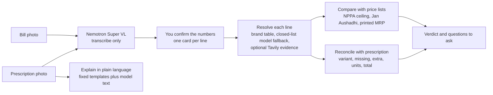
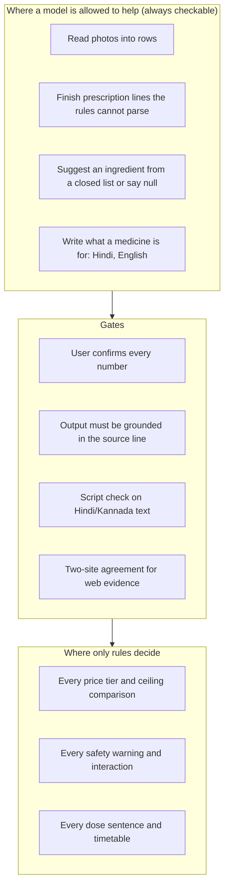

# Dawa Buddy

**A second pair of eyes on every medicine bill.**

Photograph a pharmacy or hospital bill. Dawa Buddy checks it line by line against India's legal price lists and the doctor's prescription, then tells you exactly what to ask, in English, Hindi or Kannada.


<p>
  
  &nbsp;&nbsp;
  
</p>

## TL;DR

- **What it is.** A web app for patients and caregivers. Take a photo of a medicine bill (and, if you have it, the prescription); confirm what the app read; get a short list of things worth asking about.
- **What it checks.** The price charged per tablet, strip, bottle, vial, bag or piece against the **NPPA legal ceiling price**, the **MRP printed on your bill**, and the **Jan Aushadhi generic price**; the bill against the **prescription** (missing items, extras, the wrong variant handed over); and whether the lines add up to the total.
- **What it never does.** Accuse anyone, give medical advice, or guess. Only "above a legal ceiling or the printed MRP" is a possible violation, and it is always phrased as a question. If something cannot be checked, it says so.
- **How it works.** AI models (NVIDIA Nemotron on Nebius Token Factory) *read* photos and *explain* medicines. A rules engine *decides* every price verdict and every safety note. You confirm every number before anything is judged.
- **Private.** No accounts, nothing stored. Cover names and phone numbers before uploading.
- **Open source** (MIT), 304 tests, runs locally in two minutes. The sample bills need no key and no photo.

> Dawa Buddy is information, not a finding of wrongdoing, and not medical advice.

## Contents
[Why it exists](#why-it-exists) · [Who it is for](#who-it-is-for) · [How it works for you](#how-it-works-for-you) · [What each result means](#what-each-result-means) · [Under the hood](#under-the-hood) · [Models and web evidence](#models-and-web-evidence) · [Design decisions](#design-decisions) · [Quality and evaluation](#quality-and-evaluation) · [Run it yourself](#run-it-yourself) · [Price data](#price-data-and-how-to-refresh-it) · [Limits and safety](#limits-safety-and-responsible-ai) · [Roadmap](#roadmap) · [Licence](#licence-and-acknowledgements) · [Sources](#sources)

---

## Why it exists
It started with one real prescription and its pharmacy bill, from my own family, and a simple question: *was this bill right?*

It was not simple. The prescription said **Shelcal-XT**; the counter had handed over **Shelcal 500**, a different product, and nothing on the bill said so. The bill printed the MRP *per strip* beside a *per-tablet* price, so comparing them needed a tablets-per-strip number that only the strip itself had. A hospital bill listed a saline bag at a price that looked wrong, until I found that NPPA publishes a **second, higher legal ceiling** for "special features" packs, in a separate gazette notification, and that the bag matched it to the paisa. Every one of these checks was possible. Each needed gazette PDFs, a spreadsheet and patience that a family does not have at a hospital discharge counter.

Then the court record caught up with the experience. In October 2026 a Supreme Court bench began asking why a drip line with an MRP of ₹11 was being sold for ₹304, and the Union government told the Court, in an affidavit, that patients have a "very low bargaining position" and "very limited" knowledge of drugs, substitutes and prices. That sentence is the whole problem statement. Dawa Buddy reduces that asymmetry for one patient, with one photo, in under a minute: it does the arithmetic and the lookups, says what could not be checked, and phrases every finding as a question to ask.


## The problem, with evidence
Sources are numbered and listed in [Sources](#sources). Dates are as reported.

### What the Supreme Court is hearing right now
Two bodies of litigation and the government's own filings describe the same pattern.

- **27 October 2026.** A bench of Justices Vikram Nath and Sandeep Mehta heard petitions by advocate Kishan Chand Jain and paediatric surgeon Sanjay Kulshrestha seeking stricter enforcement of the Drugs (Prices Control) Order, 2013. The bench asked how a hospital could charge **₹1.3 lakh for a cancer injection a distributor could procure for ₹11,000** and asked the Centre to justify it [3]. It noted that around **90% of medicines are outside the DPCO's price controls** [3]. Hospitals' counsel argued that capping margins would make hospital operations unviable and push costs onto other charges; the Centre argued for a "calibrated approach" and said complete control is not the answer [2]. **The order is reserved; written submissions are due in two weeks** [2]. The outcome is pending as this README is written.
- **12 October 2026.** The Centre told the Court it would cap trade margins at 30% on non-scheduled cancer drugs. The bench called that "just the tip of the iceberg" and asked about other products. Justice Mehta cited an **India-made cardiac stent costing about ₹5,000 sold by hospitals for more than ₹25,000**, and **"a saline drip line carrying an MRP of ₹11 being sold for ₹304"** [4]. The Centre's affidavit estimated the cancer-drug cap would cut MRPs by 20% to 70%, saving about ₹2,500 crore a year [4].
- **The government's affidavit** (reported 23 October 2026) calls hospitals charging high MRPs for medicines and consumables a **"malpractice"**. It says patients have a "very low bargaining position vis-a-vis the hospital, and the patient's knowledge of drugs, their substitutes and their prices is also very limited". It describes margins of **170% to 700% or more on anti-cancer drugs** and **100% to 1000% or more on consumables**, and notes that for patients paying directly, hospital supplies are **"billed separately at MRP"** [5].
- **4 March 2025, *Siddharth Dalmia v. Union of India*.** A PIL alleged that private hospitals push patients to buy medicines, implants and devices from in-house pharmacies at higher prices. Its example: an injection sold at an MRP of ₹61,132 while the same company's product was available in the open market at ₹50,000, with one free injection for every four bought that the hospital did not pass on. The bench (Justices Surya Kant and N Kotiswar Singh) left the policy to state governments [6].

### Enforcement happens late, and does not reach the patient
- NPPA, the price regulator, had demanded **₹10,029.8 crore** from manufacturers for overcharging as of 31 March 2026. **₹1,582.4 crore has been realised; ₹8,447.4 crore is outstanding**, with more than ₹5,800 crore tied up in litigation [7].
- Recovering money from companies is **not** compensation for patients. The Hindu quotes a Lok Sabha reply of 23 July 2019: "there is no mechanism to compensate the consumers for the amount overcharged" [7].
- A Parliamentary Standing Committee reported dues of ₹8,526 crore as of 30 September 2025 and recommended a dedicated legal cell in NPPA [3].

The practical consequence: after-the-fact enforcement can recover money from companies years later. It cannot fix the bill a family paid last Tuesday. The only moment a patient can act is **before paying, or while asking for a corrected bill**.

### The burden on households
- Households' out-of-pocket spending was about **43% of India's total health expenditure** in 2022-23 (₹3,82,629 crore) [8].
- In the 2025 NSS health survey, medicines averaged **₹6,368 per hospitalisation case in rural India (19.4% of the total)** and **₹6,948 in urban India (14.9%)**. Where hospitals billed a package price, medicines are hidden inside it, so the true share may be higher [7].

### Which limit applies to which line is not obvious
| Product type | Is there a legal price limit? | Can a patient see it? |
|---|---|---|
| **Scheduled medicines** (price-controlled under DPCO, 935 formulations) | Yes: a **ceiling price**, plus GST. | Only in NPPA gazette PDFs. |
| **Any pre-packed product, controlled or not** | Selling above the **printed MRP** is an offence under the Legal Metrology law [11]. | On the pack, if you can get the pack. |
| **Non-scheduled medicines** (most branded drugs) | No ceiling. NPPA regulates how fast the MRP may rise (10% a year) [13]. Manufacturers set the launch MRP. | The MRP is visible. The *trade price* behind it is not. |
| **Supplements** | No ceiling at all. Only the printed MRP applies. | MRP only. |
| **Consumables and devices** (syringes, IV sets, implants) | Routine ceilings are limited to scheduled products; devices were notified as drugs in 2020 [3]. Some devices have specific caps (coronary stents were cut by up to 85% in February 2017 [12]). | Rarely. |
| **IV fluids** | Ceilings exist, and a **second, higher ceiling** applies to "special features" packs from listed makers. | Only in separate gazette PDFs. |

The 2017 stent cap is the best argument that this works: when a limit is **fixed and public**, prices move. The problem is how few people can find the limit for the line in front of them.

### What a patient can do today
NPPA runs **Pharma Sahi Daam**, a search tool and app for the prices of scheduled and non-scheduled medicines, integrated in June 2026 with the **Pharma Jan Samadhan** complaint portal [9][10]. It is a genuine public good and Dawa Buddy points to it as the place to complain. As NPPA describes it, it is a *lookup*: you already need to know the medicine, strength and pack, and you check one medicine at a time. I found nothing in its description about reading a bill or a prescription, comparing the two, handling per-tablet versus per-strip arithmetic, or catching a dispensed variant that differs from the prescribed one. Dawa Buddy is the layer that **audits a whole bill** and hands the patient specific questions.

## Who it is for
1. **The caregiver at the discharge counter.** An adult child settling a parent's hospital pharmacy bill (injections, IV fluids, consumables) out of pocket, under time pressure, afraid of an argument. *Is anything clearly wrong, and what exactly do I say?*
2. **The chronic-medication household.** A monthly bill for blood pressure, diabetes and cholesterol tablets plus supplements. *Did I get the right product, is the printed MRP respected, is there a cheaper generic worth asking my doctor about?*
3. **The family member who reads Hindi or Kannada, not English.** *What is each medicine for, when do I take it, and what should worry me, in words I trust.*

Pharmacists and billing staff benefit too (a question is easier to answer than an accusation), as do consumer-rights volunteers and anyone filing a complaint with NPPA who needs line-level evidence.

**What the design commits to**
| Need | How the product meets it |
|---|---|
| Works from a **phone photo**, no typing | Photo upload with the camera offered on phones; the reader returns every number in each row and code picks the ones that multiply out |
| **Never accuses** | Every finding is a question; only "above a legal ceiling or the printed MRP" can be a possible violation |
| **Accuracy over coverage** | Unknown stays unknown; every audit says how much of the bill could be checked |
| **Legally meaningful comparisons** | Ceiling, printed MRP and generic reference are kept distinct |
| **Units done right** | Per tablet, strip, bottle, tube, vial, ml, IV bag and piece; no silent conversion |
| **Catches dispensing errors** | Wrong variant, missing or extra items, too many units, totals that do not add up |
| **Explains the prescription** | Dose, timetable, interactions and what is missing, in plain language |
| **Own language, safely** | Hindi and Kannada from fixed templates and tables wherever a model failed in testing |
| **Privacy** | No accounts, nothing stored, minimal data sent to services |
| **Trust under AI error** | You confirm what the model read before anything is judged |
| **Actionable** | A downloadable list of questions to ask, and the route to complain |

## The idea
> **A receipt audit, not a price lookup.** Read the bill. Work out, line by line, what was actually charged per unit. Compare it with each limit that really applies to that line. Say which limit it is, say how sure we are, and turn it into a question.

| Principle | What it means in the code |
|---|---|
| **Never accuse** | Only "above a legal ceiling or printed MRP" can be a possible violation, always phrased as a question. |
| **Rules decide, the model reads** | Nemotron transcribes, normalises and explains. It never decides a price tier and can never override a safety rule. |
| **Unknown stays unknown** | No unit, no pack size, an unreadable concentration or an unidentified brand produces *no verdict*, with a note on what is missing. |
| **Say how much we could check** | Every audit reports the share of the bill judged against a price list and against the MRP. |
| **The user confirms identity** | A model's guess at a brand's ingredient is only a suggestion; no price judgement is made until the user confirms it from the strip. |
| **Evidence, not authority** | Web results show which pages say what; agreement needs two different sites; an official order for another company's brand is context, never a limit on yours. |

**Agentic where it is safe, deterministic where it must be correct.** The app reads photos, searches NPPA and pharmacy sites and resolves brands on its own. But in a medical and legal-adjacent setting an autonomous verdict that is sometimes confidently wrong is the failure that hurts people, so every tier, every ceiling comparison and every safety rule is plain, tested code. The model proposes; a rule or the user disposes.

### What it does about the patterns reported in court
Dawa Buddy cannot fix a pricing policy. It gives a patient the numbers the policy debate is about.

| Pattern reported in the Court | What Dawa Buddy does today | Where it stops |
|---|---|---|
| **Consumable billed far above its printed MRP** (drip line, MRP ₹11, sold at ₹304) | Per-piece MRP check. The *Hospital pharmacy bill* sample reproduces it (IV set, MRP ₹11, billed ₹265). | Needs the MRP printed on the bill. |
| **A scheduled drug or injection above its legal ceiling** | Converts to per tablet, per vial or per ml and compares with the **NPPA ceiling (911 formulations loaded)** plus a GST allowance. | Scheduled medicines only; ceilings as of 1 April 2026. |
| **Non-scheduled branded drug where the MRP is many times the trade price** | Checks the bill against the printed MRP; compares with the Jan Aushadhi generic where one exists (a gap of 2x or more becomes a question *for the doctor*). | **It cannot see the price to retailer.** With no ceiling there is nothing to call illegal. It says so. |
| **Devices** (a stent at ₹5,000 vs ₹25,000+) | Reports "No price list covers this", **never "fine"**. | No device ceilings loaded yet (roadmap). |
| **The wrong product dispensed** (my own real case) | **Wrong-variant warning** naming the prescribed and billed product and what differs between their ingredient lists. | Needs the prescription. |

The data layer is a set of versioned CSV files with parsers that check their own completeness, so if the rules change, new limits can be loaded quickly.

### How it differs from price-comparison apps
Price comparison tools (for example MediSave and MedCompare, from their public home pages) help you decide **where to buy**: they compare a medicine's price across pharmacies and show generic alternatives. Dawa Buddy starts from **the bill and prescription you already have** and asks whether what you were charged is legal and what the doctor wrote. The unit of work is a *bill line*, not a medicine name. The two kinds of tool sit side by side: one helps you choose the pharmacy, the other checks the receipt.

---

## How it works for you
**One page, one question.** Start with a photo or a sample, confirm the numbers once, read the answer.

<p>
  
  &nbsp;
  
  &nbsp;
  
</p>

1. **Start.** Upload a bill photo (and optionally a prescription) or tap a sample. The samples use invented patients and prices and run fully offline against the real price lists.
2. **Check the numbers.** A banner gives the verdict first ("5 lines read. Every line multiplies out. The lines add up to the printed total, ₹648"). A line that multiplies out and needed no guess is folded into one row and approved with one tap; a line that does not add up, was hard to read, or had its numbers chosen by the reader opens with the reason. Each line is one live panel: the number billed, the price per tablet or strip, the MRP on the bill and whether it is per tablet or per strip, and tablets per strip only when a conversion needs it. A sentence under the panel recomputes at once ("You paid ₹9.81 per tablet. MRP on the bill ₹163.45 for a whole strip (₹10.90 per tablet)"). Removing a line is undoable, and a line we missed can be added. If a whole-bill discount is printed, it is read and spread over the lines for the price checks.
3. **Result.** A verdict first ("4 things to ask about", or "Nothing above a legal limit"). Tiles appear only when they carry news. **What we checked** lists each check and what it found (printed MRP, legal price ceiling, your prescription, cheaper generics, medicines to confirm), so a clean bill reads as protection. Then a card per line that needs attention, each with a **price meter**, the formulation and the ceiling or MRP it was compared with, and **how we checked this**.
4. **Ask.** Download the questions to ask the seller or doctor. Medicines that could not be matched appear under *Help us identify*, one collapsible row each: type the ingredients from the strip and confirm, or let the app read pharmacy sites for that exact product and then confirm it.
5. **Explain.** *Explain my medicines in plain language*: dose sentences, safety notes and a timetable, in English, Hindi or Kannada.

**Design choices.** Verdict first, details folded. Status is never colour alone (colour, icon and words, checked against WCAG AA contrast). Phone first: one column, controls of at least 44 px, one card per line. DM Serif Display and DM Sans for text, Noto Sans Devanagari and Kannada so Hindi and Kannada render properly. A price meter shows the amount paid against the limit, so "₹265 against ₹11" is understood without reading.

## What each result means

| Tier | Meaning | Possible violation? |
|---|---|---|
| `above_mrp` | Charged above the MRP printed on the bill (the seller's own figure; compare the strip). | Yes, for any product. |
| `above_ceiling` | Above the NPPA legal ceiling (plus a GST allowance). | Yes: ask the seller to justify it. |
| `generic_gap` | At least 2x the Jan Aushadhi price for the same ingredient and strength. | No: a question for your doctor. |
| `ask_doctor_first` | A generic exists, but switching needs the prescriber (warfarin, thyroxine, phenytoin and similar). | No. |
| `within_benchmarks` | Within the lists we hold. | No. Not a guarantee. |
| `supplement_no_ceiling` | Supplements are not price-controlled; only the printed MRP limits them. | Only via MRP. |
| `needs_confirmation` | We have a guess for the medicine but you must confirm it from the strip (or the brand may be SR/XR, or a 3-ingredient product). | Never judged. |
| `unit_unclear` | Tablet or strip? Which pack size? Does quantity x rate equal the amount? | Never judged. |
| `no_benchmark` | Identified, but no price list covers it. **Not** the same as "no ceiling exists". | No. |
| `not_covered` | Consumables, devices, rooms and procedures. | Only via MRP. |

---

## Under the hood



### The trust boundary


### Resolving a line (`bill.py`, `brand_table.py`)
1. **Whole-brand match** in a table of about **227,000 Indian brands**. Strength digits may be dropped, **letters never**: `Pan D` can never become `Pan`, and `GLYCOMET-GP` can never become `Glycomet`.
2. A plain **generic name** printed on the bill, with its strength.
3. Otherwise a **closed-list model fallback**: Nemotron must choose from generics that really exist at the strength printed, or answer `null`. Even then it is only a suggestion until the user confirms it from the strip.
4. Optional **Tavily** evidence shows which pages say what; agreement counts only when two different sites match.

**Reading messy bills.** The reader returns every number in each row; code, not the model, finds the quantity, price and line value that multiply out, makes the lines add up to the printed total, prefers the tax-inclusive value, works out a missing price, and tells a per-tablet MRP from a per-strip one. A rate printed per strip with a quantity in tablets is divided by the pack size, the way a person would. Twelve invented bill layouts with known answers (`scripts/synth_bills.py`) keep this honest.

### Pricing by form (each compares like with like and refuses to convert units it was not given)
| Form | Unit on the bill | Compared with |
|---|---|---|
| Tablet / capsule | `tab` (rate per tablet) or `strip` + `pack` (tablets per strip) | NPPA ceiling and Jan Aushadhi price per tablet |
| Syrup / suspension / drops | `bottle` + `pack` (ml) | price per ml, matched on **concentration**, not pack size |
| Cream / gel / ointment | `tube` + `pack` (gm) | price per gm |
| Injection | `vial` (or `amp`) + optional `pack` (ml it holds), or `ml` | per-vial price against per-vial lists, per-ml against per-ml; total mg and mg/ml never mixed |
| IV fluid bags | per bag, container named (glass / non-glass) | ordinary ceiling, and the higher "special features" ceiling when a listed maker or brand is named |
| Consumables and devices | `each` (per piece) | the **printed MRP** (no ceiling exists) |
| Any product | optional `mrp` (printed per pack) | the printed MRP |

### Reconciling the bill with the prescription (`reconcile.py`)
Missing items, extra items, **wrong variant** (the first brand word matches but the product differs, and *what* differs is shown from the ingredient lists), too many units for the days prescribed, and totals that do not add up.

### The plain-language briefing (`reader.py`, `safety.py`, `scheduler.py`, `explainer.py`, `i18n.py`, `medinfo.py`)
- **Dose sentences are never written by a model.** They are filled from fixed templates from the prescription (frequency, timing, days, SOS, STAT). An early version let the model write "3 times a day" for `1-0-1` and add "on an empty stomach" that nobody had prescribed.
- **Safety rules are auditable**: interactions (warfarin with aspirin or NSAIDs, nitrate with sildenafil, statin with macrolide and others), the same ingredient twice, paracetamol above 4 g a day, a missing dose or duration. Each rule has a stable code and a fixed Hindi and Kannada sentence; a test fails if a rule has no translation.
- **Hindi**: what each medicine is for and what to watch for is written by Nemotron Ultra (Super as backup), labelled "written by AI", and checked for script before it is shown. **The dose, safety notes, timetable and disclaimer are fixed Hindi templates.**
- **Kannada**: a real run showed fluent-looking nonsense from the model (place names and the word "Friday" as side effects), valid script, no meaning, which no script check can catch. So **Kannada AI text is off**. Instead, **176 common ingredients** (and combinations of them) have a **fixed table** (`medinfo.py`): a purpose phrase, side-effect phrases and warning sentences, composed mechanically and with no dose advice. An ingredient not in the table is never guessed: the reader sees the English line with a notice.
- **A timetable** and a downloadable share text, in the reader's language.


## Models and web evidence
Everything model-related runs on **Nebius Token Factory** through its OpenAI-compatible API (`dawa_buddy/llm.py`). Switching between local development and a hosted deployment is an environment variable.

| Where | Model | What it does | Why a model and not rules |
|---|---|---|---|
| Reading bill and prescription photos (`vision.py`) | NVIDIA Nemotron Super VL | Transcribes lines, numbers, units, MRP, discount and the printed total into JSON. Never judges a price. | Photos of real bills have no fixed layout. |
| Prescription reader (`reader.py`) and brand-to-ingredient fallback (`bill.py`) | Nemotron Lightning (default) | Finishes lines the rules cannot parse; picks an ingredient from a closed list or answers null. Output must be grounded in the source line. | Doctors write free text; brands outside the table. |
| Explainer, Hindi (`explainer.py`) | Nemotron Ultra, backup Super 120B | What each medicine is for and what to watch for, script-checked. | Language generation for two sentences per medicine. |
| Explainer, English | Lightning | The same two sentences in English. | Same. |
| Web evidence (`webcheck.py`, `nppa_orders.py`, `listings.py`) | Tavily search | See below. | Brands and prices that live on public web pages. |

The small fast model is the default for every everyday call (median 1.33 s per prescription over 24 cases); the vision model reads photos (a 4 MB phone photo reaches the review screen in about 5 s); the large model is used only when someone asks for a Hindi explanation (1.7 to 5 s). Model choices were made with data: Lightning answered Hindi and Kannada requests in English with no error; Super 120B mixed Bengali and Arabic letters into Kannada; Ultra's Kannada was fluent but mostly nonsense on a real prescription. That is why Kannada has a fixed table.


### Web evidence (Tavily): three uses, each as evidence for the user, never a verdict by itself
1. **Identify a brand** the tables cannot resolve (`webcheck.py`). The search returns whole pages; we read each page's *Composition* paragraph, and **drop pages about a different product** before anyone votes (a *Veltam Plus* page does not count for *Veltam*, *Concor 5* does not count for *Concor T*, a 2.5 mg page does not count for 5 mg). Two different sites agreeing is shown as agreement; a single clear answer is shown as a labelled suggestion ("only one site states this"); real disagreement is shown as disagreement. In every case the user confirms from the strip, and only the brand text is sent.
2. **NPPA price context** (`nppa_orders.py`). For a medicine with no ceiling of its own (a combination such as bisoprolol 5 mg + telmisartan 40 mg), Tavily searches `nppa.gov.in` only, phrased like NPPA's own order lists, and the rows are parsed from the official text. NPPA fixes such prices **company by company**: on a real bill, ten other companies' versions were priced at ₹11.60 to ₹12.71 per tablet before GST, and none of the orders found named the maker of the brand billed. So the app shows them as *"other brands of the same combination are price-controlled lower"*, with links to the orders and the sentence *"this is not a legal limit on your brand"*, and never as above-ceiling. Applying one company's price to another's brand would be a false accusation. Only the ingredients are sent, never prices, quantities or patient details (a test inspects the outgoing request).
3. **Pack size and listed MRP from pharmacy websites** (`listings.py`; runs by itself once after a photo is read, a button covers anything it did not reach). PharmEasy, 1mg, Truemeds and Netmeds state the strip size and the current MRP. A pack size is suggested only when two sites agree, and the MRP reference is the highest per-tablet value that two different sites support within 10%. A listed MRP is never the legal limit (1mg itself says "MRP may vary by batch"): a bill whose printed MRP is more than 10% above every listing gets a *question* ("ask to see the MRP on the strip"), never the above-MRP label. Pages are matched by name and strength so `Telma 40` never becomes `Telma H 40`.

## Design decisions
| Decision | Why | Alternative rejected |
|---|---|---|
| **Rules decide, the model reads** | A wrong price verdict is an accusation. A wrong transcription is caught by the user's confirmation. | An end-to-end model that outputs a verdict. |
| **Closed-list model fallback** | A model's brand-to-ingredient guess can be confidently wrong (it once mapped Lasix to lisinopril). Forcing a pick from ingredients that exist at the printed strength, or `null`, bounds the error. | Free-text guess. |
| **Two-site agreement for web evidence** | Single pages are wrong or stale (an outlier listing at ₹499 appeared in testing). | Trust the first result. |
| **Company-specific NPPA orders are context, not limits** | NPPA fixes prices per company; another company's price is not a limit on this brand. | Show the lowest controlled price as "the ceiling". |
| **Fixed templates for dose, safety and timetable text** | Medical sentences must be reviewable once and identical every time. | Let the model write them. |
| **Units are explicit; no silent conversion** | The commonest overcharge illusion is per-tablet versus per-strip. | Guess the unit. |
| **The printed MRP is the seller's own figure** | "Within the MRP on your bill" only proves the bill agrees with itself. The wording says so everywhere, and listed MRPs from pharmacy sites raise a question, never a verdict. | Treat the printed MRP as the legal limit. |
| **Versioned CSV data with self-checking parsers** | The parser stops unless serial numbers run 1..N with no gap and every price is a number. | Hand-copied numbers. |
| **Streamlit** | Fast to iterate, free hosting, Python end to end. | A separate web front end: more polish potential, much more to build and host. |
| **A shared daily budget for hosted deployments** | A public link spends credits on every photo read and AI explanation. Three counters for the whole app fall back to the rules-based mode when used up, so the samples and every price check always keep working. | A per-visitor access code (kept as an option); hoping nobody finds the link. |
| **No accounts, no storage** | Bills contain personal data. | Saving history. |
| **Samples that need no key** | Anyone can see the product work in one tap. | Require an API key to try. |

---

## Quality and evaluation
All numbers are reproducible with the commands below. Where a number is weak, it says so.

| Check | Result | Caveat |
|---|---|---|
| Unit and integration tests | **304 pass** | Includes fake-server tests for the Ollama and Tavily paths and a test that inspects what is sent to Tavily. |
| Brand resolution, 108 real brand lines | **99 correct, 4 missed (safe), 0 wrong.** Supplements, invented and ambiguous names handled safely. | Expected answers were written from pharmaceutical knowledge; a pharmacist should review them. |
| Bill tier accuracy, 18 synthetic lines | **18 of 18** | Synthetic prices written by the author. |
| Bill reader, 12 synthetic layouts | 58 of 58 rows read to the known answer | Stress tests the reader was tuned against; not an accuracy figure. |
| Prescription extraction, 24 synthetic cases | Offline rules F1 **1.00**, live Nemotron F1 **1.00**; 0 invented medicines; median latency 1.33 s | **Saturated**: the rules were tuned on this style of text. The real-photo comparison is more telling. |
| Real bill photos | Every number transcribed correctly on the first two bills tried; later real bills (tax-inclusive columns, stacked cells, a whole-bill discount, per-strip rates with tablet quantities) each exposed a reader bug that is now fixed and tested | A handful of bills: an anecdote, not a benchmark. |
| Real prescription photos | 11 lines: the model kept the full product name where the rules truncated 7; 1 error (`STAT` read as `SOS`); one dose pattern `0---1---0` read as `0---0` | Two prescriptions. This is why every transcription is shown for confirmation. |
| Hindi and Kannada explainer, live | Hindi: good in every run I read. Kannada: accepted by the script check **but a real run produced fluent nonsense**, so Kannada AI text is off. | The script check proves the alphabet, not the meaning. |
| LLM second-opinion reviews of the fixed Hindi and Kannada text and of the medicine table (several models from different families, **no native speaker or clinician**) | Found and fixed real errors: a Kannada grammar error, a double-verb bug, an unsafe line ("drink plenty of water" on a diuretic) and 150+ missing warnings, each reusing a warning that was already written and translated | Review by models is a screen, not a clinical review. See `docs/language_review.md`. |
| NPPA price context for an unpriced combination (live) | 10 company rows from 4 NPPA documents parsed correctly for one combination | One combination; anything not in the expected layout returns nothing, not a guess. |
| Pharmacy-website lookup, real bill (live) | Pack sizes right for 6 of 6 products where the strip is known; printed-MRP check possible on 4 of 4 lines | One bill. |
| **Not yet measured** | Handwriting, many other bill layouts, real-user outcomes, native-speaker and clinician review | |

```bash
pytest -q tests                                   # 304 tests
python -m evals.run_bill_evals                    # 18 synthetic bill lines, tier accuracy
python -m evals.run_brand_evals [--verbose]       # 108 brand lines: correct / missed / wrong
python -m evals.run_evals --out evals/results.md  # 24 synthetic prescriptions, live model
python -m evals.run_lang_evals --out evals/results_lang.md   # Hindi and Kannada explainer, live models
DAWA_PROVIDER=offline python -m evals.run_evals --out evals/results_offline.md
```

### What real bills and prescriptions taught the design
Synthetic tests passed long before real documents did. Some of the changes real data forced:
- **A saline bag billed ₹45.22 was flagged above the ordinary ₹20.15 ceiling.** NPPA publishes a second, higher ceiling for "special features" packs; all three notifications are now loaded and the bag matches ₹43.07 plus 5% GST to the paisa. The *question, never an accusation* design is what kept the earlier flag harmless.
- **Another company's NPPA price was about to be shown as a brand's limit.** NPPA fixes prices company by company, so those prices are now context ("not a legal limit on your brand"), never above-ceiling.
- **The rules-only reader truncated 7 of 11 product names** (`Concor T` became `Concor`), which would have produced false wrong-variant cards. Names are kept whole and completed deterministically from the printed line.
- **The model read `STAT` as `SOS`, and dropped a `1` from `0---1---0`.** `STAT` is its own frequency, the parser accepts any dashes, and the review screen warns when a prescription line has no readable dose.
- **Fluent nonsense in Kannada** led to the fixed table.
- **Bills print numbers many ways** (tax-inclusive MRP, stacked cells, rate per strip with quantity in tablets, a whole-bill discount). Reading them by arithmetic, not by templates, is now the reader's job.
- **A missing table cell is `NaN` on newer pandas**, which is truthy; units silently defaulted wrongly on the hosted app but not in local tests. Fixed, with a test.
- **A generic more than twice as cheap** is now surfaced as a question for the doctor (the threshold started at 3x and was judged too relaxed).
- **"Within the MRP printed on your bill"** only proves the bill agrees with itself, so the wording and the review of such lines say exactly that.
- **Consumables had no "per piece" option**, so the headline court example (₹11 billed at ₹304) was missed until it was added.

---

## Run it yourself

Python 3.10+. **No key and no photo?** Open the app and press one of the two **sample bills**; they run fully offline against the real price lists.
```bash
git clone https://github.com/aadih88/dawa-buddy.git
cd dawa-buddy
python -m venv .venv && source .venv/bin/activate
pip install -r requirements-dev.txt     # requirements.txt is the runtime-only set
cp .env.example .env                    # then put your keys in .env (it is git-ignored)
set -a; source .env; set +a             # load the keys into this shell
streamlit run bill_app.py
```

**Phones.** The app is a responsive web page: open it in a phone browser and the file picker offers the camera. One column, one card per line, no table to scroll sideways; tested on a phone. Uploads up to 25 MB are accepted (phone photos are 3 to 12 MB; they are shrunk before being sent to the model).

**Deploy on Streamlit Community Cloud**
1. Push the repository to GitHub (public; MIT).
2. On [share.streamlit.io](https://share.streamlit.io) choose *Create app*, pick the repository and branch, set the main file to `bill_app.py`, and under *Advanced settings* choose Python 3.11 and paste your secrets:
   ```toml
   NEBIUS_API_KEY = "..."
   TAVILY_API_KEY = "..."            # optional
   DAWA_MAX_PHOTO_READS = "15"       # photo reads per unlocked visitor session (the default is 5)
   # DAWA_ACCESS_CODE = "..."       # optional: visitors start locked (samples and price checks only) until they enter it. Leave unset for an open deployment.
   DAWA_DAILY_PHOTO_READS = "100"    # shared by all visitors, per day (00:00 UTC): photo reads
   DAWA_DAILY_MODEL_CALLS = "600"    # model calls per day
   DAWA_DAILY_WEB_CALLS = "400"      # web look-ups per day
   ```
3. Deploy. The first build installs `requirements.txt` (about two minutes); an idle app sleeps and wakes when someone visits.

**Daily budget and optional access code.** A hosted deployment can be open (no code). Three shared counters (`dawa_buddy/budget.py`) cap photo reads, model calls and web look-ups per day for the whole app. When one is used up the app falls back to the rules-based mode: the sample bills and every price check keep working, the start screen says the AI part is paused, and it resets at 00:00 UTC. The counters are in memory (a restart resets them), so the hard limit is the balance on the API keys: use a separate key with a small prepaid balance for the demo. `DAWA_MAX_PHOTO_READS` still caps each visitor session. If you prefer a gate, set `DAWA_ACCESS_CODE`: every visitor then starts *locked* (`llm.restrict`, per visitor thread) until the code is entered, and a wrong guess costs 1.5 s. Streamlit exposes top-level secrets as environment variables, which is what the app reads. If the start screen shows only the sample buttons and no photo upload, the key is not reaching the app (check the secret's name) or today's budget is used up. Memory is not a concern: loading the brand table and running an audit peaks at about 190 MB.

**Command line (no browser)**
```bash
python scripts/check_nebius.py my_data/bill.JPG          # confirms key, text model and vision work
python scripts/read_photos.py --bill my_data/bill.JPG --rx my_data/prescription.JPG [--truth my_data/bill_truth.txt]
python scripts/audit_bill.py --bill my_data/bill.txt --rx my_data/rx.txt --total 1165 [--lookup]
```
`read_photos.py` writes `<photo name>_read.txt` for you to check against the paper. `--truth` scores the transcription against a bill you typed by hand. `--lookup` adds Tavily evidence for unidentified brands.

**Bill text format** (`my_data/bill.txt`, one line per item; a line starting with `#` is a comment, and comments must be on their own line):
```
description | qty | rate | amount | unit | pack | mrp
# tablet: rate per tablet, MRP per strip of 15 tablets
SHELCAL 500MG TAB | 30 | 9.81 | 294.21 | tab | 15 | 163.45
# syrup: a 60 ml bottle
OMNACORTIL FORTE SYRUP | 1 | 90.00 | 90.00 | bottle | 60
# injection: priced per vial
CEFTRIAXONE 250MG INJ | 1 | 29.50 | 29.50 | vial
# IV bag: name the container (glass / non-glass) if you know it
NS 0.9% 100ML NON-GLASS | 13 | 21.00 | 273.00
# consumable: per piece, with the MRP printed on the bill
IV SET | 2 | 265.00 | 530.00 | each | | 11.00
```
`mrp` is always the MRP printed on the **pack** (per strip, bottle, tube, vial or piece), as bills print it. With a per-tablet rate, give `pack` (tablets per strip) so the tool can compare.

**Modes**
| `DAWA_PROVIDER` | Behaviour |
|---|---|
| `nebius` (default when `NEBIUS_API_KEY` is set) | Nemotron on Token Factory |
| `ollama` | Local model, no cloud (`OLLAMA_MODEL`, `DAWA_VISION_MODEL`) |
| `offline` | Rules only, clearly labelled; no photo reading |

Optional: `DAWA_DAILY_PHOTO_READS`, `DAWA_DAILY_MODEL_CALLS`, `DAWA_DAILY_WEB_CALLS` (shared daily budget), `DAWA_ACCESS_CODE` (gate for a hosted demo), `DAWA_TEXT_MODEL`, `DAWA_VISION_MODEL`, `NEBIUS_BASE_URL`, `TAVILY_API_KEY`, `DAWA_KN_MODEL_TEXT=1` (turns the experimental Kannada AI text back on, for testing only).

## Price data and how to refresh it
| Data | Source | In the repo |
|---|---|---|
| NPPA ceilings, 911 formulations | Three gazette notifications of 25.03.2026, effective 1.4.2026 (WPI +0.64956%): 767 under NLEM 2022, 138 under NLEM 2015, 6 under NLEM 2011 | `data/nppa_ceiling_2026-04.csv` |
| NPPA ceilings, March 2026 posters | Category posters (cancer, diabetes, TB, HIV, cardio), kept only for 34 formulations the gazettes lack | `data/nppa_ceiling_2026-03.csv` |
| IV fluids in "special features" packs | Three gazette notifications of 25.03.2026 and the manufacturers entitled to them | `data/nppa_ivfluids_special_2026-04.csv`, `data/nppa_special_makers_2026-04.csv` |
| Jan Aushadhi prices | PMBJP product list, 21 Oct 2026 | `data/janaushadhi_2026-10-21.csv` |
| Brand to composition, about 227,000 names | [junioralive/Indian-Medicine-Dataset](https://github.com/junioralive/Indian-Medicine-Dataset) (MIT). Its prices are from 2022 and are discarded | `data/brand_index.json` (14 MB) |
| Hand-checked 3-ingredient brands | The brand table keeps at most two actives, so these are verified against sources | `data/brand_overrides.json` |

Sources and attribution: `data/NOTICE.md`. NPPA's PDFs are not committed; download them from NPPA and rebuild:
```bash
python3 -I scripts/parse_nppa_gazette.py data/nppa_ceiling_2026-04.csv "1 April 2026 (WPI-revised)" \
    nlem2022=NPPA-ceilings.pdf nlem2015=138-drug-revision.pdf nlem2011=six-drug-revision.pdf
python3 -I scripts/parse_nppa_ivfluids.py data/nppa_ivfluids_special_2026-04.csv data/nppa_special_makers_2026-04.csv \
    "1 April 2026 (WPI-revised)" rl=ringer_lactate.pdf six=6-special-features.pdf eight=8-special-features.pdf
python3 scripts/build_brand_index.py indian_medicine_data.csv
```
The parsers are **checked, not trusted**: serial numbers must run 1..N with no gap and every price must be a number, otherwise they stop. A cross-check found 233 of 267 poster rows matching the new lists with identical prices. NPPA revises ceilings every April, and the Supreme Court proceedings may add new limits; when they do, download the notifications and re-run the parsers.


---

## Limits, safety and responsible AI
- **It is not medical advice and not a legal finding.** It never diagnoses and never changes a dose. Every flag is a prompt to ask someone.
- **It cannot see the price to retailer**, which is what the Supreme Court's concern is mostly about. It can compare with legal ceilings, the printed MRP and generic reference prices, and say "no price list covers this". It does not claim to detect a mark-up inside the MRP.
- **Coverage is partial.** NPPA ceilings exist only for scheduled drugs; most branded medicines have none. Devices, rooms and procedures have no price list loaded. The tool reports the share it could check and never presents "no benchmark" as "fine".
- **A consumable's MRP check needs the MRP to be read off the pack and a unit chosen.** It makes no assumption about an MRP it was not given.
- **The brand table is third-party** and keeps at most two ingredients per product. A table hit is priced but labelled "check the strip"; combinations that match a benchmark go to `needs_confirmation`; a product listed only as SR/XR when the bill does not say so also does.
- **Special-features IV packs** have maker-specific restrictions in NPPA's notes. Naming a listed manufacturer is treated as a signal, not proof.
- **GST allowance.** Ceilings exclude local taxes; the tool allows up to 12% before flagging, which can hide a small overcharge but avoids false alarms.
- **Photos may contain personal data.** Cover names, phone numbers, addresses and bill numbers before uploading. Photos are sent to Nebius Token Factory to be read; only brand or ingredient text goes to Tavily; the app stores nothing.
- **Interaction and brand-safety tables are small demo sets** to be replaced with a licensed clinical database before real use.
- **Hindi and Kannada.** Fixed text (dose, safety notes, timetable, disclaimer, and the Kannada medicine table) is never model-written, but has had **only an LLM second-opinion review** (two passes; they found and fixed real errors, including an unsafe "drink plenty of water" on a diuretic, see [Quality and evaluation](#quality-and-evaluation)); **no native speaker or clinician has reviewed it yet**, and the medicine table's medical content in particular needs a pharmacist or doctor. The Hindi AI text is labelled as AI and can contain mistakes. See `docs/language_review.md`.
- **Known small gaps.** "With food" and "with milk" timings are not understood (only after food, before food and bedtime). A combination with two strengths on one line (for example `5mg/40`) shows only the first strength. A misread dose that is still *readable* (a wrong digit, not a missing one) is not caught.
- **Unverified:** wording of the fixed Hindi and Kannada text, the Hindi AI text over many prescriptions, handwriting and real-user outcomes.

**Responsible-AI design in one paragraph.** The model never decides a price tier or a safety rule; every transcription is confirmed by the user; model output must be grounded in the source text; web evidence needs two independent sites and is labelled as context; non-English medical text is template-based or table-based wherever a model failed in testing; failures are reported as "we could not check this", not hidden; and the tool names the complaint route instead of acting on its own.

## Roadmap
Not built, in order of impact. Ideas, not promises.
1. **Device ceilings.** NPPA already caps some devices (coronary stents, knee implants). Loading them would turn "not covered" into a real comparison for the biggest consumable mark-ups.
2. **New limits from the Supreme Court proceedings.** If trade-margin caps beyond cancer drugs follow, load them as another versioned list. The 30% cap on 137 non-scheduled cancer drugs takes effect on 9 November 2026 [2].
3. **A complaint draft** for Pharma Sahi Daam / Pharma Jan Samadhan, pre-filled with the line, the limit and the amount.
4. **More languages** (Tamil, Telugu, Marathi, Bengali) using the same fixed-table approach, after native-speaker review.
5. **Handwriting and package bills** (a single hospital package price with no itemisation).
6. **Serve the models from dedicated endpoints**, and use batch jobs for batch re-checks when a price list is revised.
7. **A real-user study**, including pharmacists, to tune wording.

## Licence and acknowledgements
MIT (see `LICENSE`). Data attributions are in `data/NOTICE.md`. Thanks to the owner of the real redacted bills and prescriptions used for validation, and to the teams behind NPPA's public notifications, the PMBJP product list and the open Indian medicine dataset.


## Sources
Accessed 28 October 2026 unless noted. Figures in the news reports are as reported; court outcomes are pending where stated.

2. The Hindu, "SC says 'economic policy' cannot take precedence over lives as Centre backs 'calibrated' drug-price controls", 27 Oct 2026. https://www.thehindu.com/news/national/sc-says-economic-policy-cannot-take-precedence-over-lives-as-centre-backs-calibrated-drug-price-controls/article71631892.ece
3. ThePrint, "'Not through this dacoity': SC questions Rs 1.3 lakh hospital charge for Rs 11,000 cancer injection", 27 Oct 2026. https://theprint.in/health/not-through-this-dacoity-sc-questions-rs-1-3-lakh-hospital-charge-for-rs-11000-cancer-vaccine/3083192/
4. The Hindu, "Supreme Court wants cap on trade margin for all essential medicines and medical products", 12 Oct 2026 (updated 17 Oct). https://www.thehindu.com/sci-tech/health/supreme-court-wants-cap-on-trade-margin-for-all-essential-medicines-and-medical-products/article71575807.ece
5. Times of India, "Hospitals 'overcharging' is a malpractice: Govt to Supreme Court", 23 Oct 2026. https://timesofindia.indiatimes.com/india/hospitals-overcharging-is-a-malpractice-govt-to-supreme-court/articleshow/135130460.cms
6. PTI via ET Pharma, "Policy decisions by states needed to protect patients from being fleeced by pharmacies at private hospitals: SC", 5 Mar 2025. https://pharma.economictimes.indiatimes.com/news/policy-and-regulations/policy-decisions-by-states-needed-to-protect-patients-from-being-fleeced-by-pharmacies-at-private-hospitals-sc/118721289
7. The Hindu (Data Point), "₹8,447 crore in medicine overcharging claims remain outstanding as SC seeks wider price controls", 22 Oct 2026, citing NPPA and NSS Report no. 596 (Household Social Consumption: Health, 2025). https://www.thehindu.com/data/8447-crore-in-medicine-overcharging-claims-remain-outstanding-as-sc-seeks-wider-price-controls/article71607884.ece
8. National Health Systems Resource Centre, National Health Accounts Estimates for India 2022-23. https://nhsrcindia.org/sites/default/files/2026-05/NHA%202022-23%20Report.pdf
9. PIB, "NPPA Integrates Pharma Jan Samadhan Portal with Pharma Sahi Daam Portal", 25 Jun 2026. https://www.pib.gov.in/PressReleasePage.aspx?PRID=2304731&reg=48&lang=1
10. NPPA, Pharma Sahi Daam. https://nppa.gov.in/pharma_sahi_daam
11. Consumer Awareness Group, "Maximum Retail Price (MRP) and Over-Charging". https://www.cag.org.in/blogs/maximum-retail-price-mrp-and-over-charging
12. Legal 500, "NPPA Revises The Ceiling Price Of Coronary Stent" (the February 2017 cap, up to 85%). https://www.legal500.com/intelligence/india/food-drugs-healthcare-life-sciences/nppa-revises-the-ceiling-price-of-coronary-stent
13. PIB, 8 Aug 2025, on NPPA ceiling prices and the 10% annual rule for non-scheduled medicines (cited when first written; not re-fetched for this revision). https://www.pib.gov.in/PressReleasePage.aspx?PRID=2154217
14. IJCMPH, a single-site Mumbai hospital-pharmacy study of outpatients' knowledge of their prescriptions (about 12% good knowledge; small study). https://www.ijcmph.com/index.php/ijcmph/article/view/5450
15. NPPA gazette notifications of 25.03.2026 (ceiling prices); PMBJP product list; junioralive/Indian-Medicine-Dataset (MIT). See `data/NOTICE.md`.

## Repository layout
```
bill_app.py                 The app (Streamlit): photo or sample -> confirm -> verdict, cards, questions, plain-language briefing
docs/                       Screenshots used in this README; language_review.md (reviewer pack)
dawa_buddy/
  bill.py                   Line resolution, tiers, per-form pricing, MRP check (incl. per-piece consumables)
  brand_table.py            Brand -> composition lookup (whole-brand, never guesses)
  benchmarks.py, ceilings.py  Jan Aushadhi and NPPA loaders and matchers
  liquids.py, injectables.py  Per-ml / per-gm, per-vial and IV-fluid pricing
  reconcile.py              Prescription vs bill, wrong-variant warning
  vision.py                 Photo -> structured rows (downscales large photos)
  webcheck.py, nppa_orders.py, listings.py   Tavily: brand evidence, NPPA order context, pharmacy-site pack size and MRP
  reader.py, safety.py, explainer.py, scheduler.py, pipeline.py   Prescription reading and the plain-language briefing
  review_triage.py          Which bill lines need a person (ok / check / fix), the lines-against-total check, the whole-bill discount
  transparency.py           The reference numbers behind each verdict ("How we checked this")
  i18n.py, medinfo.py       Fixed Hindi and Kannada text; the fixed Kannada/English medicine table (no model)
  llm.py                    Nebius / Ollama / offline client
  report.py                 "Questions to ask" document
  ui.py                     Visual layer: design tokens, fonts, widget restyling, HTML builders
  samples.py                Two built-in synthetic sample bills (one-click demo, no key needed)
data/                       Price lists, brand table, overrides, NOTICE.md
scripts/                    audit_bill, read_photos, check_nebius, NPPA PDF parsers, brand-table builder, review-pack builder (markdown), review-sheet builder (xlsx for reviewers: one row per phrase, a verdict dropdown), synth_bills (twelve invented bill layouts with known answers), clinical_review (second-opinion screen of the medicine table by other model families)
evals/                      Gold sets and runners
tests/                      304 tests
my_data/                    Your private bills and prescriptions (git-ignored)
```
