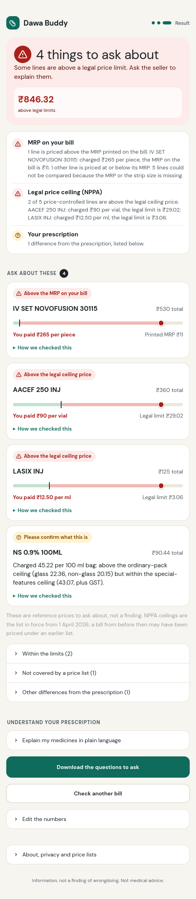
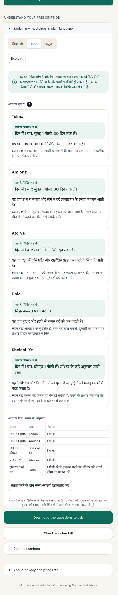
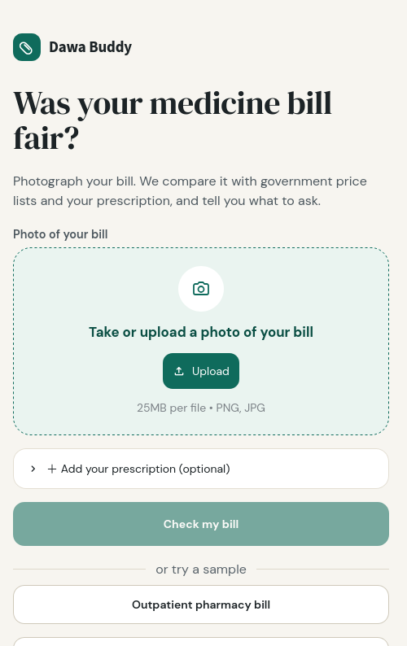
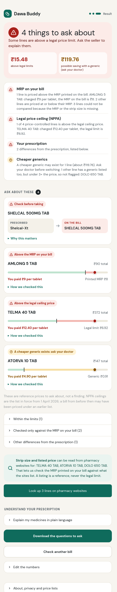
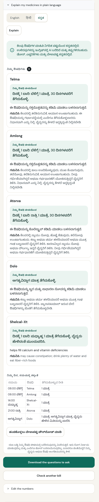
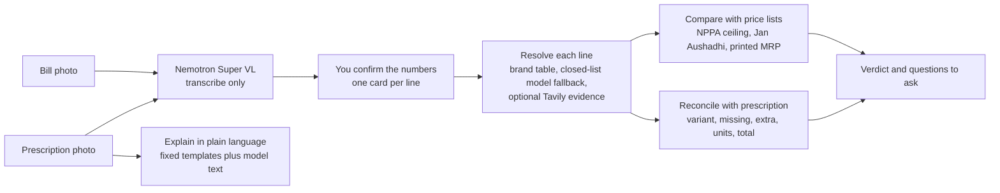
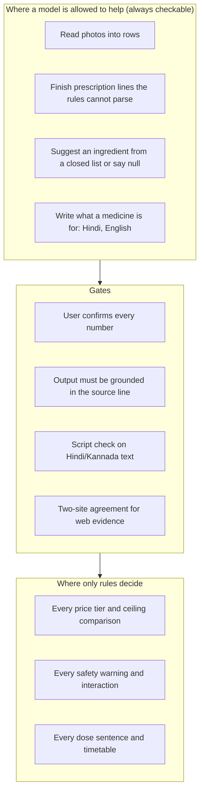

# Dawa Buddy

### A second pair of eyes on every medicine bill

**Photograph a pharmacy or hospital bill. Dawa Buddy checks it line by line against India's legal price lists and the doctor's prescription, then tells you exactly what to ask, in English, Hindi or Kannada.**


**Demo:** the hosted app's URL and its access code are in the submission's testing instructions (the link is not published here, so that strangers cannot spend the model credits; see [section 13](#13-setup-run-and-deploy)) · **Demo video (3 min): link added at submission** · [Hackathon page](https://nebiusglobalaihackathon.devpost.com/) · Track: **Best Apps and Agents**

> Dawa Buddy never accuses anyone. It reads your documents, compares them with public price lists and the prescription, and tells you **what to ask**.
> It is information, not a finding of wrongdoing, and not medical advice.

<p>
  
  &nbsp;&nbsp;
  
</p>

### Try it in 30 seconds (no key, no upload)
1. Open the demo link from the submission (or run it locally in two minutes, [section 13](#13-setup-run-and-deploy)), tap **Hospital pharmacy bill**, look over the numbers on the *Check the numbers* screen, and press **See the result**. The sample bills and every price check work **without** the access code.
2. The first card is an **IV set billed at ₹265 against an MRP of ₹11 printed on the pack**. That is the kind of mark-up a Supreme Court bench has been questioning this month (see [section 2](#2-the-problem-with-evidence)). The injections below it are above their **legal ceiling prices**.
3. Enter the access code from the testing instructions (*I have an access code*) to switch on photo reading, AI text and web look-ups. Then open **Explain my medicines in plain language**, choose **हिन्दी** or **ಕನ್ನಡ**, and press *Explain*. Without the code, the dose, safety notes and timetable still appear (they are fixed templates).
4. With the code you can also upload your own bill photo (cover names and phone numbers first).

### What a judge should know in one minute
| Criterion | Short answer | Where to look |
|---|---|---|
| **Technological implementation** | Nemotron **Super VL** reads photos, **Lightning** reads prescriptions, **Ultra / Super** write Hindi, all through one Token Factory endpoint. A deterministic rules engine decides every price verdict, so the model can never invent an accusation. 264 tests; 4 evaluation suites. | [§7](#7-architecture), [§8](#8-how-we-use-nebius-nvidia-nemotron-and-tavily), [§10](#10-validation-and-evaluation) |
| **Design** | One question per screen, verdict first, a "What we checked" list so a clean bill reads as protection, phone-first, status always colour + icon + words, Hindi and Kannada typography. | [§5](#5-the-product-tour) |
| **Potential impact** | The Indian government's own court affidavit says patients have "very low bargaining position" and "very limited" knowledge of prices. This tool puts the comparison in the patient's hands at the moment of paying. | [§2](#2-the-problem-with-evidence), [§4](#4-the-idea) |
| **Quality of the idea** | A *receipt audit*, not a price lookup: it resolves each line to a medicine, strength and form, converts per-tablet, per-strip, per-vial, per-ml and per-piece prices correctly, and reconciles the bill with the prescription (including the wrong *variant* handed over). It is honest about what it cannot see. | [§4](#4-the-idea), [§9](#9-engineering-decisions-and-why) |

---

## Contents
**Part I. The case:** [1 Why I built this](#1-why-i-built-this) · [2 The problem, with evidence](#2-the-problem-with-evidence) · [3 Who it is for and what they need](#3-who-it-is-for-and-what-they-need) · [4 The idea](#4-the-idea)
**Part II. The product:** [5 The product tour](#5-the-product-tour) · [6 What each result means](#6-what-each-result-means)
**Part III. The technology:** [7 Architecture](#7-architecture) · [8 Nebius, NVIDIA Nemotron and Tavily](#8-how-we-use-nebius-nvidia-nemotron-and-tavily) · [9 Engineering decisions](#9-engineering-decisions-and-why)
**Part IV. The proof:** [10 Validation and evaluation](#10-validation-and-evaluation) · [11 Requirements traceability](#11-how-it-meets-the-requirements) · [12 Hackathon checklist](#12-hackathon-requirements-checklist)
**Part V. Run it:** [13 Setup, run, deploy](#13-setup-run-and-deploy) · [14 Price data and refresh](#14-price-data-and-how-to-refresh-it)
**Part VI. Honesty:** [15 Limits, safety, responsible AI](#15-limits-safety-and-responsible-ai) · [16 Roadmap](#16-roadmap) · [17 Feedback](#17-feedback-on-nebius-token-factory-and-nvidia-models) · [18 Prior work, licence](#18-prior-work-licence-acknowledgements) · [19 Sources](#19-sources)

---

# Part I. The case

## 1. Why I built this
I started with one real prescription and its pharmacy bill, from my own family, and tried to answer a simple question: *was this bill right?*

It was not simple. The prescription said **Shelcal-XT**; the counter had handed over **Shelcal 500**, a different product, and nothing on the bill said so. The bill printed the MRP *per strip* beside a *per-tablet* price, so comparing them needed a tablets-per-strip number that only the strip itself had. A hospital bill listed a saline bag at a price that looked wrong, until I found that NPPA publishes a **second, higher legal ceiling** for "special features" packs, in a separate gazette notification, and that the bag matched it to the paisa. Every one of these checks was possible. Each needed gazette PDFs, a spreadsheet and patience that a family does not have at a hospital discharge counter.

Then the court record caught up with the experience. In October 2026 a Supreme Court bench began asking why a drip line with an MRP of ₹11 was being sold for ₹270, and the Union government told the Court, in an affidavit, that patients have a "very low bargaining position" and "very limited" knowledge of drugs, substitutes and prices. That sentence is the whole problem statement. Dawa Buddy is my attempt to reduce that asymmetry for one patient, with one photo, in under a minute: do the arithmetic and the lookups, say what could not be checked, and phrase every finding as a question to ask, never an accusation.

## 2. The problem, with evidence
Sources are numbered and listed in [section 19](#19-sources). Dates are as reported.

### 2.1 What the Supreme Court is hearing right now
Two bodies of litigation and the government's own filings describe the same pattern.

- **27 October 2026 (yesterday).** A bench of Justices Vikram Nath and Sandeep Mehta heard petitions by advocate Kishan Chand Jain and paediatric surgeon Sanjay Kulshrestha seeking stricter enforcement of the Drugs (Prices Control) Order, 2013. The bench asked how a hospital could charge **₹1.3 lakh for a cancer injection a distributor could procure for ₹11,000** and asked the Centre to justify it [3]. It noted that around **90% of medicines are outside the DPCO's price controls** [3]. Hospitals' counsel argued that capping margins would make hospital operations unviable and push costs onto other charges; the Centre argued for a "calibrated approach" and said complete control is not the answer [2]. **The order is reserved; written submissions are due in two weeks** [2]. The outcome is pending as this README is written.
- **12 October 2026.** The Centre told the Court it would cap trade margins at 30% on non-scheduled cancer drugs. The bench called that "just the tip of the iceberg" and asked about other products. Justice Mehta cited an **India-made cardiac stent costing about ₹5,000 sold by hospitals for more than ₹25,000**, and **"a saline drip line carrying an MRP of ₹11 being sold for ₹270"** [4]. The Centre's affidavit estimated the cancer-drug cap would cut MRPs by 20% to 70%, saving about ₹2,500 crore a year [4].
- **The government's affidavit** (reported 23 October 2026) calls hospitals charging high MRPs for medicines and consumables a **"malpractice"**. It says patients have a "very low bargaining position vis-a-vis the hospital, and the patient's knowledge of drugs, their substitutes and their prices is also very limited". It describes margins of **170% to 700% or more on anti-cancer drugs** and **100% to 1000% or more on consumables**, and notes that for patients paying directly, hospital supplies are **"billed separately at MRP"** [5].
- **4 March 2025, *Siddharth Dalmia v. Union of India*.** A PIL alleged that private hospitals push patients to buy medicines, implants and devices from in-house pharmacies at higher prices. Its example: an injection sold at an MRP of ₹61,132 while the same company's product was available in the open market at ₹50,000, with one free injection for every four bought that the hospital did not pass on. The bench (Justices Surya Kant and N Kotiswar Singh) left the policy to state governments [6].

### 2.2 Enforcement happens late, and does not reach the patient
- NPPA, the price regulator, had demanded **₹10,029.8 crore** from manufacturers for overcharging as of 31 March 2026. **₹1,582.4 crore has been realised; ₹8,447.4 crore is outstanding**, with more than ₹5,800 crore tied up in litigation [7].
- Recovering money from companies is **not** compensation for patients. The Hindu quotes a Lok Sabha reply of 23 July 2019: "there is no mechanism to compensate the consumers for the amount overcharged" [7].
- A Parliamentary Standing Committee reported dues of ₹8,526 crore as of 30 September 2025 and recommended a dedicated legal cell in NPPA [3].

The practical consequence: after-the-fact enforcement can recover money from companies years later. It cannot fix the bill a family paid last Tuesday. The only moment a patient can act is **before paying, or while asking for a corrected bill**.

### 2.3 The burden on households
- Households' out-of-pocket spending was about **43% of India's total health expenditure** in 2022-23 (₹3,82,629 crore) [8].
- In the 2025 NSS health survey, medicines averaged **₹6,368 per hospitalisation case in rural India (19.4% of the total)** and **₹6,948 in urban India (14.9%)**. Where hospitals billed a package price, medicines are hidden inside it, so the true share may be higher [7].

### 2.4 Which limit applies to which line is not obvious
| Product type | Is there a legal price limit? | Can a patient see it? |
|---|---|---|
| **Scheduled medicines** (price-controlled under DPCO, 935 formulations) | Yes: a **ceiling price**, plus GST. | Only in NPPA gazette PDFs. |
| **Any pre-packed product, controlled or not** | Selling above the **printed MRP** is an offence under the Legal Metrology law [11]. | On the pack, if you can get the pack. |
| **Non-scheduled medicines** (most branded drugs) | No ceiling. NPPA regulates how fast the MRP may rise (10% a year) [13]. Manufacturers set the launch MRP. | The MRP is visible. The *trade price* behind it is not. |
| **Supplements** | No ceiling at all. Only the printed MRP applies. | MRP only. |
| **Consumables and devices** (syringes, IV sets, implants) | Routine ceilings are limited to scheduled products; devices were notified as drugs in 2020 [3]. Some devices have specific caps (coronary stents were cut by up to 85% in February 2017 [12]). | Rarely. |
| **IV fluids** | Ceilings exist, and a **second, higher ceiling** applies to "special features" packs from listed makers. | Only in separate gazette PDFs. |

The 2017 stent cap is the best argument that this works: when a limit is **fixed and public**, prices move. The problem is how few people can find the limit for the line in front of them.

### 2.5 What a patient can do today
NPPA runs **Pharma Sahi Daam**, a search tool and app for the prices of scheduled and non-scheduled medicines, integrated in June 2026 with the **Pharma Jan Samadhan** complaint portal [9][10]. It is a genuine public good and Dawa Buddy points to it as the place to complain. As NPPA describes it, it is a *lookup*: you already need to know the medicine, strength and pack, and you check one medicine at a time. I found nothing in its description about reading a bill or a prescription, comparing the two, handling per-tablet versus per-strip arithmetic, or catching a dispensed variant that differs from the prescribed one. Dawa Buddy is the layer that **audits a whole bill** and hands the patient specific questions.

## 3. Who it is for and what they need
**Three people the design is built around**
1. **The caregiver at the discharge counter.** An adult child settling a parent's hospital pharmacy bill (injections, IV fluids, consumables) out of pocket, under time pressure, afraid of an argument. Needs: *is anything clearly wrong, and what exactly do I say?*
2. **The chronic-medication household.** A monthly bill for blood pressure, diabetes and cholesterol tablets plus supplements. Needs: *did I get the right product, is the printed MRP respected, is there a cheaper generic worth asking my doctor about?*
3. **The family member who reads Hindi or Kannada, not English.** Needs: *what is each medicine for, when do I take it, and what should worry me, in words I trust.*

Secondary users: pharmacists and billing staff (a question is easier to answer than an accusation), consumer-rights volunteers, and anyone filing a complaint with NPPA who needs line-level evidence.

**What they told the design (pain points to requirements)**
| # | Requirement | Why |
|---|---|---|
| R1 | Works from a **phone photo**, no typing | Nobody retypes a bill at a counter. |
| R2 | **Never accuses**; every finding is a question | Wrongful accusations destroy trust and are unfair to honest sellers. |
| R3 | **Accuracy over coverage**: unknown stays unknown, and say how much was checked | A false "all clear" or a false alarm is worse than "we could not check this". |
| R4 | **Legally meaningful comparisons**: ceiling, printed MRP and generic reference kept distinct | They mean different things; mixing them misleads. |
| R5 | **Units done right**: per tablet, strip, bottle, tube, vial, ml, IV bag, piece | Unit confusion is the commonest cause of apparent overcharging and of missed overcharging. |
| R6 | **Catch dispensing errors** (wrong variant, missing or extra items) | A cheap bill for the wrong medicine is not a good bill. |
| R7 | **Explain the prescription**: dose, timetable, interactions, what is missing | Understanding the medicine is half of using it safely. |
| R8 | **Own language, safely** (Hindi, Kannada) | A wrong word in a medical sentence is a safety risk. |
| R9 | **Privacy**: no accounts, nothing stored, minimal data sent | Bills carry names, phone numbers and diagnoses. |
| R10 | **Trust under AI error**: user confirms what the model read | Models misread digits; people act on numbers. |
| R11 | **Free, no sign-up, works without a key** | Judges and patients both need to try it instantly. |
| R12 | **Actionable output**: questions to ask, downloadable, and a route to complain | A finding with no next step is just worry. |

Section [11](#11-how-it-meets-the-requirements) maps each requirement to the feature that meets it and the evidence.

## 4. The idea
> **A receipt audit, not a price lookup.** Read the bill. Work out, line by line, what was actually charged per unit. Compare it with each limit that really applies to that line. Say which limit it is, say how sure we are, and turn it into a question.

### Principles that shape every decision
| Principle | What it means in the code |
|---|---|
| **Never accuse** | Only "above a legal ceiling or printed MRP" can be a possible violation, always phrased as a question. Everything else is a prompt to ask. |
| **Rules decide, the model reads** | Nemotron transcribes, normalises and explains. It never decides a price tier and can never override a safety rule. |
| **Unknown stays unknown** | No unit, no pack size, an unreadable concentration or an unidentified brand produces *no verdict*, with a note on what is missing. |
| **Say how much we could check** | Every audit reports the share of the bill judged against a price list and against the MRP. |
| **The user confirms identity** | A model's guess at a brand's ingredient is only a suggestion; no price judgement is made until the user confirms it from the strip. |
| **Evidence, not authority** | Web results show which pages say what; agreement needs two different sites; an official order for another company's brand is context, never a limit on yours. |

### Why this is not "an agent that decides"
The track is *Best Apps and Agents*, and the obvious build is an autonomous agent that researches prices and passes judgement. I chose not to. In a medical and legal-adjacent setting, an autonomous verdict that is sometimes confidently wrong is the failure mode that hurts people. Dawa Buddy is **agentic where it is safe** (it reads photos, searches NPPA and pharmacy sites with Tavily, resolves brands) and **deterministic where it must be correct** (every tier, every ceiling comparison, every safety rule). The model proposes; a rule or the user disposes.

### What the court-reported patterns mean for this tool (honestly)
Dawa Buddy cannot fix a pricing policy. It can give a patient the numbers the policy debate is about. Here is exactly what it does and does not do for each pattern reported in court.

| Pattern reported in the Court | What the patient can see | What Dawa Buddy does today | Where it stops |
|---|---|---|---|
| **Consumable billed far above its printed MRP** (drip line, MRP ₹11, sold at ₹270) | The MRP on the pack and the billed rate | **Per-piece MRP check.** Flags "Above the MRP printed on the pack" with the price meter. The *Hospital pharmacy bill* sample reproduces it (IV set, MRP ₹11, billed ₹265). | Needs the MRP read off the pack. It cannot know an MRP it was not given. |
| **A scheduled drug or injection above its legal ceiling** | Bill rate, strength, form | Converts to per tablet, per vial or per ml and compares with the **NPPA ceiling (911 formulations loaded)** plus a GST allowance. The sample shows two injections above ceiling. | Scheduled medicines only; ceilings as of 1 April 2026. |
| **Non-scheduled branded drug where the MRP is many times the trade price** (₹2,700 bought, MRP ₹27,000) | Only the MRP | Checks the bill against the printed MRP; compares with the **Jan Aushadhi generic price** where a generic exists (a gap of 3x or more becomes a question *for the doctor*); shows pharmacy-site listings as a reference. | **It cannot see the price to retailer.** The heart of the Court's concern is invisible to the patient, and with no ceiling there is nothing to call illegal. It says so. |
| **A hospital charging a drug at many times what a distributor pays** (₹11,000 vs ₹1.3 lakh) | MRP and billed rate | Flags only if the bill exceeds the printed MRP; otherwise reports "within the printed MRP" and any generic benchmark. | Same limit: a mark-up *within* MRP is a policy question, not something a bill can prove. |
| **Devices** (a stent at ₹5,000 vs ₹25,000+) | Little | Reports "No price list covers this", **never "fine"**. | No device ceilings are loaded yet (roadmap). Some do exist. |
| **Being pushed to the in-house pharmacy** | Nothing on the bill | Nothing. | A policy problem. |
| **The wrong product dispensed** (our own real case) | Prescription vs bill | **Wrong-variant warning** that names the prescribed and the billed product and shows what differs between their ingredient lists. | Needs the prescription. |

If the Court's final order changes the rules, the tool's data layer is a set of versioned CSV files with parsers that check their own completeness ([§14](#14-price-data-and-how-to-refresh-it)), so new limits can be loaded quickly. Whatever the rules turn out to be, a patient still needs to see them applied to the bill in front of them.

---

# Part II. The product

## 5. The product tour
**One page, one question.** Start with a photo or a sample, confirm the numbers once, read the answer.

<p>
  
  &nbsp;
  
  &nbsp;
  
</p>

| Step | What happens | Why |
|---|---|---|
| **1. Start** | Upload a bill photo (and optionally a prescription) and press **Read my bill**, or tap a sample. Every control is disabled while the photo is read. | The first thing a visitor can do is try it. Samples run with no key and take the same road as a photo. |
| **2. Check the numbers** | Press **See the result** when it matches your paper. One card per bill line shows what was read (to compare with the paper), how it was sold (per tablet, strip, bottle, tube, vial, piece), pack size and printed MRP. **Edits are staged:** *Fix a number* is a small form (item, quantity, price, MRP) that applies only on **Save changes**; the total is always quantity × price, and a line whose printed total does not add up is marked. **Removing is undoable:** a removed line moves to *Removed lines* with **Put back**. *Add a line we missed* is the same kind of form with an **Add this line** button. **Nothing needed is easy to miss:** one amber note at the top names every line that still needs a number (usually tablets per strip, for a printed MRP that is per strip), the field is flagged on the card, a **Find strip sizes online** button sits right there, and the caption above *See the result* says what will be skipped if the gap is left. If a prescription line has no readable dose, one amber note lists those lines and opens the prescription box. | A misread digit must never become an accusation (R10), and a step that matters must not be skippable by accident. |
| **3. Result** | A verdict first ("4 things to ask about", or "Nothing above a legal limit"). Tiles appear **only when they carry news**: the rupees above a legal limit, or a possible generic saving. A zero is never shown as a result. Under it, **What we checked** lists each check and what it found: *printed MRP* (green tick: at or below on N lines), *legal price ceiling* (grey "not applicable" when none of the medicines is price-controlled, which is normal), *your prescription* (matches, or N differences), *cheaper generics* (only when one exists) and *medicines to confirm*. Then a card per line that needs attention, each with a **price meter**. Lines within limits and lines no list covers are folded away. | A clean bill must read as protection, not as a screen of zeros, and a check that does not apply is explained, not hidden. |
| **4. Ask** | **Download the questions to ask** the seller or doctor. Medicines that could not be matched appear under *Help us identify*, **one collapsible row per medicine** with its status in the title ("needs your confirmation" or "confirmed"), so the section stays short however many there are. In a row, type the ingredients from the strip and press **Confirm ingredients**; the result above updates at once, the box gives way to what was confirmed (with a **Change ingredients** link), and a line says what changed; or let the app read pharmacy sites for that exact product, then confirm it against the strip. A button that has done its job is disabled for the rest of the session ("Looked up online", "Using: …"), so nothing can be pressed twice to no effect. | Output a person can act on (R12), and the section is never a dead end. |
| **5. Explain** | *Explain my medicines in plain language*: dose sentences, safety notes, timetable, in English, Hindi or Kannada. | R7 and R8. |

### Design decisions
- **Verdict first, details folded.** An earlier version put an About section, two tabs and tables of numbers on the first screen. It read like a portfolio page, not an app. The redesign was shown as a mockup first, then built.
- **Status is never colour alone.** Red, amber, green and grey each pair a colour with an icon *and* words ("Above the legal ceiling price"). A test checks the palette against WCAG AA contrast.
- **Phone first.** One column, controls at least 44 px, one card per bill line instead of a table, camera offered by the file picker. Checked at phone width in a headless browser; a physical phone is still to do.
- **Typography for the reader.** DM Serif Display for the verdict, DM Sans for text, Noto Sans Devanagari and Kannada so Hindi and Kannada render properly.
- **A price meter.** The bar shows the amount paid against the limit, so "₹265 against ₹11" is understood without reading.

## 6. What each result means
| Tier | Meaning | Possible violation? |
|---|---|---|
| `above_mrp` | Charged above the MRP printed on the pack. | Yes, for any product. |
| `above_ceiling` | Above the NPPA legal ceiling (plus a GST allowance). | Yes: ask the seller to justify it. |
| `generic_gap` | At least 3x the Jan Aushadhi price for the same ingredient and strength. | No: a question for your doctor. |
| `ask_doctor_first` | A generic exists, but switching needs the prescriber (warfarin, thyroxine, phenytoin and similar). | No. |
| `within_benchmarks` | Within the lists we hold. | No. Not a guarantee. |
| `supplement_no_ceiling` | Supplements are not price-controlled; only the printed MRP limits them. | Only via MRP. |
| `needs_confirmation` | We have a guess for the medicine but you must confirm it from the strip (or the brand may be SR/XR, or a 3-ingredient product). | Never judged. |
| `unit_unclear` | Tablet or strip? Which pack size? Does quantity x rate equal the amount? | Never judged. |
| `no_benchmark` | Identified, but no price list covers it. **Not** the same as "no ceiling exists". | No. |
| `not_covered` | Consumables, devices, rooms and procedures. | Only via MRP. |

---

# Part III. The technology

## 7. Architecture


### The trust boundary


### Resolving a line (`bill.py`, `brand_table.py`)
1. **Whole-brand match** in a table of about **227,000 Indian brands**. Strength digits may be dropped, **letters never**: `Pan D` can never become `Pan`, and `GLYCOMET-GP` can never become `Glycomet`.
2. A plain **generic name** printed on the bill, with its strength.
3. Otherwise a **closed-list model fallback**: Nemotron must choose from generics that really exist at the strength printed, or answer `null`. Even then it is only a suggestion until the user confirms it from the strip.
4. Optional **Tavily** evidence shows which pages say what; agreement counts only when two different sites match.

### Pricing by form (each compares like with like and refuses to convert units it was not given)
| Form | Unit on the bill | Compared with |
|---|---|---|
| Tablet / capsule | `tab` (rate per tablet) or `strip` + `pack` (tablets per strip) | NPPA ceiling and Jan Aushadhi price per tablet |
| Syrup / suspension / drops | `bottle` + `pack` (ml) | price per ml, matched on **concentration**, not pack size |
| Cream / gel / ointment | `tube` + `pack` (gm) | price per gm |
| Injection | `vial` (or `amp`) + optional `pack` (ml it holds), or `ml` | per-vial price against per-vial lists, per-ml against per-ml; total mg and mg/ml never mixed |
| IV fluid bags | per bag, container named (glass / non-glass) | ordinary ceiling, and the higher "special features" ceiling when a listed maker or brand is named |
| Consumables and devices | `each` (per piece) | the **printed MRP** (no ceiling exists) |
| Any product | optional `mrp` (printed per pack) | the printed MRP |

### Reconciling the bill with the prescription (`reconcile.py`)
Missing items, extra items, **wrong variant** (the first brand word matches but the product differs, and *what* differs is shown from the ingredient lists), too many units for the days prescribed, and totals that do not add up.

### The plain-language briefing (`reader.py`, `safety.py`, `scheduler.py`, `explainer.py`, `i18n.py`, `medinfo.py`)
- **Dose sentences are never written by a model.** They are filled from fixed templates from the prescription (frequency, timing, days, SOS, STAT). An early version let the model write "3 times a day" for `1-0-1` and add "on an empty stomach" that nobody had prescribed.
- **Safety rules are auditable**: interactions (warfarin with aspirin or NSAIDs, nitrate with sildenafil, statin with macrolide and others), the same ingredient twice, paracetamol above 4 g a day, a missing dose or duration. Each rule has a stable code and a fixed Hindi and Kannada sentence; a test fails if a rule has no translation.
- **Hindi**: what each medicine is for and what to watch for is written by Nemotron Ultra (Super as backup), labelled "written by AI", and checked for script before it is shown. **The dose, safety notes, timetable and disclaimer are fixed Hindi templates.**
- **Kannada**: a real run showed fluent-looking nonsense from the model (place names and the word "Friday" as side effects), valid script, no meaning, which no script check can catch. So **Kannada AI text is off**. Instead, **176 common ingredients** (and combinations of them) have a **fixed table** (`medinfo.py`): a purpose phrase, side-effect phrases and warning sentences, composed mechanically and with no dose advice. An ingredient not in the table is never guessed: the reader sees the English line with a notice.
- **A timetable** and a downloadable share text, in the reader's language.

## 8. How we use Nebius, NVIDIA Nemotron and Tavily
Everything model-related runs on **Nebius Token Factory** through its OpenAI-compatible API (`https://api.tokenfactory.nebius.com/v1/`, `dawa_buddy/llm.py`). Moving between local development and the hosted demo is an environment variable.

| Where | Model (ID) | What it does | Why a model and not rules |
|---|---|---|---|
| Reading bill and prescription photos (`vision.py`) | `nvidia/Nemotron-3.5-Super-VL` | Transcribes lines, numbers, units, MRP and the printed total into JSON. Never judges a price. | Photos of real bills have no fixed layout. |
| Prescription reader (`reader.py`) and brand-to-ingredient fallback (`bill.py`) | `nvidia/Nemotron-3_5-Lightning` (default) | Finishes lines the rules cannot parse; picks an ingredient from a closed list or answers null. Output must be grounded in the source line. | Doctors write free text; brands outside the table. |
| Explainer, Hindi (`explainer.py`) | `nvidia/Nemotron-3-Ultra-550b-a55b`, backup `nvidia/nemotron-3-super-120b-a12b` | What each medicine is for and what to watch for, in Hindi, script-checked. | Language generation for two sentences per medicine. |
| Explainer, English | Lightning | The same two sentences in English. | Same. |
| Web evidence (`webcheck.py`, `nppa_orders.py`, `listings.py`) | **Tavily** search | See below. | Brands and prices that live on public web pages. |

**Which Nemotron for which job.** The track guidance is to reach for Ultra when you need serious capability and let smaller models handle fast, everyday calls. We did exactly that and measured it: the small fast **Lightning** model is the default for every everyday call (median **1.33 s** per prescription over 24 cases); the **vision** model reads photos (a 4 MB phone photo reaches the review screen in about **5 s** on the hosted app, one measurement); the large **Ultra** model is used only when someone asks for a Hindi explanation (1.7 to 5 s in the checks). A per-session cap on photo reads (`DAWA_MAX_PHOTO_READS`) keeps a public link from spending credits.

**Where Token Factory accelerated the work.**
- One OpenAI-compatible endpoint served a vision model, a small fast text model and two large models, with **no custom client** and a per-task model switch by environment variable. That let us *test model choice with data* instead of guessing: `models.list()` confirmed the exact IDs on the day we integrated (27 October 2026).
- It made the negative results cheap to find, which became product decisions: Lightning answered Hindi and Kannada requests in English with no error; Super 120B mixed Bengali and Arabic letters into Kannada; Ultra's Kannada was fluent but, on a real prescription, three of four side-effect lines were nonsense. That is why Kannada has a fixed table. Per-model language benchmarks would have saved a day, and I say so in [section 17](#17-feedback-on-nebius-token-factory-and-nvidia-models).

**What a real photo taught us about the models.** On 11 lines from two real prescriptions we compared the rules-only reader with the model. The rules **truncated the product name on 7 of 11 lines** (`Concor T` became `Concor`, `Roseday Gold` became `Roseday`, `Glycomet-500 Sr` became `Glycomet-`). That matters directly, because the wrong-variant warning depends on the *full* product name. The model kept the full name on all of them. It made one mistake (it read `STAT`, give once now, as `SOS`, as needed) and on a prescription where the dose was printed `0---1---0` it dropped the `1`. Both led to changes ([section 10.3](#103-what-real-data-broke-and-what-we-changed)).

**Not used.** Nebius Serverless Endpoints, Serverless Jobs and AI Cloud are not used; the demo is hosted on Streamlit Community Cloud and calls Token Factory at runtime. They are encouraged but not required, and listed in the [roadmap](#16-roadmap).

### Tavily: three runtime uses, each as evidence for the user, never a verdict by itself
1. **Identify a brand** the tables cannot resolve (`webcheck.py`). The search returns whole pages; we read each page's *Composition* paragraph, and **drop pages about a different product** before anyone votes (a *Veltam Plus* page does not count for *Veltam*, *Concor 5* does not count for *Concor T*, a 2.5 mg page does not count for 5 mg). Two different sites agreeing is shown as agreement; a single clear answer is shown as a labelled suggestion ("only one site states this"); real disagreement is shown as disagreement. In every case the user confirms from the strip, and only the brand text is sent.
2. **NPPA price context** (`nppa_orders.py`). For a medicine with no ceiling of its own (a combination such as bisoprolol 5 mg + telmisartan 40 mg), Tavily searches `nppa.gov.in` only, phrased like NPPA's own order lists, and the rows are parsed from the official text. NPPA fixes such prices **company by company**: on a real bill, ten other companies' versions were priced at ₹11.60 to ₹12.71 per tablet before GST, and none of the orders found named the maker of the brand billed. So the app shows them as *"other brands of the same combination are price-controlled lower"*, with links to the orders and the sentence *"this is not a legal limit on your brand"*, and never as above-ceiling. Applying one company's price to another's brand would be a false accusation. Only the ingredients are sent, never prices, quantities or patient details (a test inspects the outgoing request).
3. **Pack size and listed MRP from pharmacy websites** (`listings.py`, one button). PharmEasy, 1mg, Truemeds and Netmeds state the strip size and the current MRP. A pack size is suggested only when two sites agree, and the MRP reference is the highest per-tablet value that two different sites support within 10%. A listed MRP is never the legal limit (1mg itself says "MRP may vary by batch"): a bill whose printed MRP is more than 10% above every listing gets a *question* ("ask to see the MRP on the strip"), never the above-MRP label. Pages are matched by name and strength so `Telma 40` never becomes `Telma H 40`.

## 9. Engineering decisions (and why)
| Decision | Why | Alternative rejected |
|---|---|---|
| **Rules decide, the model reads** | A wrong price verdict is an accusation. A wrong transcription is caught by the user's confirmation. | An end-to-end model that outputs a verdict. |
| **Closed-list model fallback** | A model's brand-to-ingredient guess can be confidently wrong (it once mapped Lasix to lisinopril). Forcing a pick from ingredients that exist at the printed strength, or `null`, bounds the error. | Free-text guess. |
| **Two-site agreement for web evidence** | Single pages are wrong or stale (an outlier listing at ₹499 appeared in testing). | Trust the first result. |
| **Company-specific NPPA orders are context, not limits** | NPPA fixes prices per company; another company's price is not a limit on this brand. | Show the lowest controlled price as "the ceiling". |
| **Fixed templates for dose, safety and timetable text** | Medical sentences must be reviewable once and identical every time. | Let the model write them. |
| **Script and meaning gating for non-English text** | A script check proves the alphabet, not the meaning, so for Kannada we also removed free-form AI text. | Ship AI Kannada behind a script check. |
| **Units are explicit; no silent conversion** | The commonest overcharge illusion is per-tablet versus per-strip. | Guess the unit. |
| **Versioned CSV data with self-checking parsers** | The parser stops unless serial numbers run 1..N with no gap and every price is a number. This caught a merged-cell row (`Condoms 11.65`) the table reader had skipped. | Hand-copied numbers. |
| **Streamlit** | Fast to iterate, free hosting, Python end to end; the widget restyling is pinned to one Streamlit version. | A separate web front end: more polish potential, much more to build and host in the time. |
| **An access code that switches off all model and web calls, per visitor** | A hosted link can be found or leaked, and every photo read and AI explanation costs credits. Locked visitors still get the samples and every rules-based price check, so nothing is hidden; judges get everything with the code. A test fails if a locked visitor makes any model or web call. | Keeping the link secret and hoping; a Streamlit viewer allow-list (judges cannot be given a shared login). |
| **No accounts, no storage** | Bills contain personal data. | Saving history. |
| **Samples that need no key** | Anyone, including a judge, can see the product work in one tap. | Require an API key to try. |

---

# Part IV. The proof

## 10. Validation and evaluation
All numbers below are reproducible with the commands in [section 13](#13-setup-run-and-deploy). Where a number is weak, it says so.

### 10.1 Results
| Check | Result | Caveat |
|---|---|---|
| Unit and integration tests | **264 pass** | Includes fake-server tests for the Ollama and Tavily paths and a test that inspects what is sent to Tavily. |
| Brand resolution, 108 real brand lines | **99 correct, 4 missed (safe), 0 wrong.** The curated map alone: 26 correct, 61 missed, 2 wrong (1 reached a price verdict). 14 of 14 supplements, invented and ambiguous names handled safely. | Expected answers were written from pharmaceutical knowledge, **not** copied from the table. A pharmacist should review them. |
| Bill tier accuracy, 18 synthetic lines (tablets, liquids, injections) | **18 of 18** | Synthetic prices written by the author. |
| Prescription extraction, 24 synthetic cases | Offline rules F1 **1.00**, live Nemotron F1 **1.00**; safety-flag F1 1.00 / 1.00; 0 invented medicines; median latency 1.33 s | **Saturated**: the rules were tuned on this style of text, so it does not show the model's value. The real-photo comparison does. |
| Real bill photos (two bills) | 4 of 4 and 5 of 5 lines transcribed with every number correct | Two bills: an anecdote, not a benchmark. |
| Real prescription photos | 11 lines: the model kept the full product name where the rules truncated 7; 1 error (`STAT` read as `SOS`); one dose pattern `0---1---0` was read as `0---0` | Two prescriptions. This is why every transcription is shown for confirmation. |
| Hindi and Kannada explainer, live | Hindi: good in every run I read, accepted by the script check, 1.7 to 5 s. Kannada: accepted by the script check **but a real run produced fluent nonsense**, so Kannada AI text is off. | Script check proves the alphabet, not the meaning. An LLM second-opinion review (28 Oct 2026, see the next row) marked **9 of 14 Kannada AI lines as nonsense**, one of them dangerous ("black stools" rendered as "black weakness"), which independently confirms that Kannada AI text must stay off; it found **no nonsense in the 14 Hindi AI lines** (meaning right in 13). **No native speaker or clinician has reviewed Hindi or Kannada yet.** |
| Second-opinion review of the fixed Hindi and Kannada text and of the medicine table (28 Oct 2026, by an LLM: **not a native speaker or a clinician**) | Hindi fixed text: 82 of 88 rows OK. Kannada fixed text: 80 of 88 OK. Kannada medicine table: 132 of 147 OK. Medicine map (176 ingredients): 65 OK, 111 flagged, nearly all as "add a warning". **Applied:** 5 Hindi and 8 Kannada wording fixes (including a real Kannada grammar error: "like {drug}" had been written as "as {drug} does"); 14 table fixes (including a double-verb bug: several pieces ended in "to use" before the frame's "is used"); and 132 warning additions across 93 ingredients, each reusing a warning that was already written and translated, with my own clinical judgement on top (no "never in pregnancy" for statins, letrozole or clomiphene; none for low sugar on teneligliptin). **Not applied:** about 20 free-text requests that need new wording (listed for a clinician), and 3 stylistic changes. | An LLM shares blind spots with the model that wrote the text, so this is a second opinion, not a review. The files for human reviewers are `docs/language_review.md` and the reviewer spreadsheet (`scripts/build_review_sheet.py`). |
| Third pass on the English medicine table (28 Oct 2026): two models from other families (Qwen3-235B, DeepSeek-V4-Pro) screened all 176 ingredients, then a stronger model reviewed the 54 they flagged (`scripts/clinical_review.py`; all LLMs, **no clinician**) | The first two over-flagged (152 of 176 "flagged by both" until missing-warning suggestions were ranked below wrong-warning flags). The stronger model rated 40 of the 54 purposes OK and 14 incomplete (another common use left out), **none wrong**. It found one unsafe line: torasemide said "drink plenty of water", which is wrong advice for a diuretic used in heart or kidney failure. **Applied:** that line removed, and 18 more warnings across 17 ingredients, each reusing an existing translated sentence (alcohol for sedating or liver-affecting drugs, allergy, blood tests for two ACE inhibitors, pregnancy for amlodipine and norethisterone). **Not applied:** about 40 suggested new sentences (new unreviewed text after the feature freeze), and a stricter pregnancy sentence for letrozole and clomiphene, which women take in order to conceive. | Disagreement between reviewers was the useful signal; a single model's "missing" list was mostly padding. Still no human review of the medicine content. |
| NPPA price context for an unpriced combination (live, Tavily) | 10 distinct company rows from 4 NPPA documents for bisoprolol 5 mg + telmisartan 40 mg, parsed correctly against rows copied from the documents | One combination live. Only the "composition, unit, company, price" layout is parsed; anything else returns nothing, not a guess. |
| Pharmacy-website lookup, real bill (live, Tavily) | **Pack sizes right for 6 of 6 products where the strip is known**; the **printed-MRP check became possible on 4 of 4 lines** with one button (2 of 4 before), while no line has a government price list entry (the page says so plainly); listed MRPs matched the printed MRP for Concor T and Shelcal. One brand (Pantop) had no two sites within 10% and correctly got no reference. | 6 products, one day. Listings change and sites disagree, so every result is a question. |
| Online ingredient lookup, 4 real brands (live, Tavily) | Concor T 5/40 and Veltam 0.4: **two sites agree** after the fix (neither did before). Glycomet 500 SR: one clear answer, labelled as a suggestion. Roseday Gold: the pharmacy sites **genuinely disagree** and the app says so. 4 pages about similar-named products were ignored for each brand. | 4 brands, one day. Pages that state no composition (several Apollo and Netmeds pages) still add nothing. |
| Live hosted app (28 Oct 2026, before the access code was added) | Sample bill to verdict; a real 4.2 MB bill photo to the review screen in about 5 s | Manual check, one run. |
| **Not yet measured** | Handwriting, other bill layouts, real-user outcomes, native-speaker review, a physical phone | |

### 10.2 Reproduce
```bash
pytest -q tests                                   # 264 tests
python -m evals.run_bill_evals                    # 18 synthetic bill lines, tier accuracy
python -m evals.run_brand_evals [--verbose]       # 108 brand lines: correct / missed / wrong
python -m evals.run_evals --out evals/results.md  # 24 synthetic prescriptions, live model
python -m evals.run_lang_evals --out evals/results_lang.md   # Hindi and Kannada explainer, live models
DAWA_PROVIDER=offline python -m evals.run_evals --out evals/results_offline.md
```

### 10.3 What real data broke, and what we changed
Synthetic tests passed long before real documents did. These are the failures real bills and prescriptions caused, which is why the design looks as it does.

| What went wrong | What we changed |
|---|---|
| A saline bag billed ₹45.22 was flagged above the ordinary ceiling of ₹20.15. | NPPA publishes a second, higher ceiling for "special features" packs from listed makers. We loaded all three notifications; the bag matched ₹43.07 plus 5% GST to the paisa. The earlier flag was wrong in effect, and the *question, never an accusation* design is what kept it harmless. |
| The rules-only reader truncated 7 of 11 product names (`Concor T` to `Concor`). | The model-assisted reader keeps the full name, kept honest by a rule that its output must be grounded in the source line. |
| The model read `STAT` as `SOS`; the dose line then said "as needed". | The reader now treats `STAT` as its own single-dose frequency, and every transcription is shown for confirmation. |
| A dose printed `0---1---0` was read by the vision model as `0---0`, and the dose parser accepted only single dashes. The app said "ask your doctor how to take it". | A prompt that copies dose patterns character by character; a parser that accepts any dashes; and an amber warning on the review screen that lists any prescription line with no readable dose and opens the box to fix it. A real bug caught by running real data. |
| A prescription line `0-0-1 ... SOS in case of constipation` was shown as a daily dose. | "SOS" now wins over printed digits; injections and syrups say "dose", not "tablet". |
| An NPPA price of ₹12.55 to ₹12.62 for a combination was quoted to me as Concor T's limit. | Those were other companies' orders. NPPA fixes price company by company, so they became *context* ("not a legal limit on your brand"), never an accusation. |
| Pharmacy-site parsing read a pack of 1 from a URL ending `-1`; an outlier listing (Pantop ₹499) set a bad MRP reference. | Patterns per source; a reference needs two different sites within 10%. |
| A real run of Kannada AI text was fluent nonsense in valid script. | Kannada AI text off; a fixed, reviewable table for common ingredients; a fixed notice when the table does not cover a medicine. |
| The same "Something is not written" card repeated for every medicine. | One grouped note per kind of issue. |
| After the user typed an ingredient, the cards and verdict stayed stale until the next click, so the *Help us identify* box looked like it did nothing. | The page now refreshes in the same step, the box stays open and says what the confirmation did ("Compared as … No price list covers this"). |
| The online ingredient lookup almost never reached agreement. The cause was extraction, not the web: it read only the short search snippet with one rigid pattern, and the search mixed in neighbouring products. | Read each page's *Composition* paragraph; ignore pages about a different product or strength; show a single clear answer as a labelled suggestion. |
| The result card showed three tiles: rupees above limits, rupees of generic saving and a percentage of the bill checked. On a clean bill that meant "₹0, ₹0, 0%", which read as "the tool found nothing" when the truth is "you are covered"; and the percentage had merged two different checks (the printed MRP, and a government price list). | Tiles appear only when they carry news. A **What we checked** list says what was verified and found fine (printed MRP, legal ceiling, prescription), and explains in grey when a check does not apply. No percentage, no empty generic saving. |
| The model-assisted prescription reader returned "Concor" for "CONCOR T 5MG/40" in 1 of 3 live runs. It passed the grounding check (the word is in the line) and produced a false red wrong-variant card. | Brand names are completed deterministically from the words that follow them in the printed line (stopping at a number, comma, route or frequency word): `Concor` becomes `Concor T`, `Roseday` becomes `Roseday Gold`. Regression tests cover both reader paths. |
| Jan Aushadhi writes "Prolonged **release**" with a space; the name parser only ignored the hyphenated form, so "prolonged" was read as an *ingredient* and metformin SR never matched its own 500 mg price (₹1.08 a tablet; a bill charging ₹3.60 got no comparison). Found while debugging why a real bill showed 0%. | "prolonged" is ignored like "sustained" and "extended"; a regression test pins it. Evals unchanged (18/18; 99 correct, 4 safe misses, 0 wrong). |
| The result page gave no sign of progress as ingredients were confirmed, and no reason when the price-list figure stayed at 0%. | It lists what is not identified yet (the list shrinks as you confirm), shows what each confirmation did, and when no list covers any medicine says so plainly. |
| In the *Help us identify* box the look-up and "use it" buttons stayed active after use, inviting repeat searches and doubt about what had happened; with several medicines the single box grew very long. | Each button disables once it has done its job (and re-enables only if the user changes the text it acted on). Each medicine gets its own collapsed row, with the row the user last worked in kept open. |
| The ingredients box had no button: a Streamlit text box only applies on Enter or when you click away, so users typed and nothing visibly happened. It also stayed on screen after the answer was confirmed. | A form with an explicit **Confirm ingredients** button (pressing it also confirms a value suggested from the brand table, which used to need an edit). Once confirmed, the box is replaced by the confirmed value and its outcome, with a **Change ingredients** link so a typo is not a dead end. |
| The "Explain my medicines" row sat directly under the identify rows and read as part of that list (the stylesheet stitches adjacent expanders into one group); "Change ingredients" had no colour or padding (and, once tinted, matched the "confirmed" banner above it). | The explainer has its own heading ("Understand your prescription"); "Change ingredients" uses the same primary style as "Confirm ingredients". |
| Three parts of the result disagreed about which medicines needed confirming: the *Help us identify* list included Veltam (identified as tamsulosin, merely not price-listed) while the alert cards and the checklist row did not; and the checklist row was missing for AI-guessed medicines like Concor T. | One rule, `needs_identifying()`, decides it for all three: an AI or brand-table guess awaiting confirmation, or a line that matched nothing. A test checks the checklist row and the identify list name exactly the same medicines. |
| After every ingredient was confirmed the section still read "Help us identify (1)", which says an action is pending. | The badge counts only what is still pending. When nothing is, the header becomes "Medicines you confirmed (N)" with "Nothing more to do here"; the answers stay listed so they can be reviewed or changed (a typo must not be permanent). |
| On the review screen, *Fix a number* applied edits live (an accidental keystroke changed the bill), *Remove this line* could not be undone, quantity, price **and** total were all editable (so they could disagree), *Add a line* had no clear confirm and an unstyled button, and a missing strip size (needed to check a per-strip MRP) was easy to overlook: Veltam came pre-filled from the brand table but Shelcal and Concor T did not. | Edits are staged in a form with **Save changes**; the total is computed; removed lines go to *Removed lines* with **Put back**; *Add this line* is a validated form with a primary button; an amber note and a per-card flag name every missing strip size, with **Find strip sizes online** beside them; the results-page look-up now says which medicines it covers and why. |
| The MRP row of *What we checked* read "Charged above the printed MRP on 1 line of 4. 3 other lines are within it.": correct but unreadable, with no line named and no amounts. | Each row now names the line and both prices: "1 line is priced above the MRP printed on the pack. IV SET NOVOFUSION 30115: charged ₹265 per piece, the pack says ₹11." The ceiling row does the same with the legal limit. |
| The daily timetable listed *strengths* ("500MG after food", "5MG/40", "As written") where a person needs an *amount*; a vaccine (a STAT single dose) sat in it as "as needed"; and a syrup written "0-0-1 … SOS in case of constipation" appeared every night when the model read the line (it kept the digits and lost the word). | Rows now say what to take: "1 tablet (500 mg), after food", "15 ml", "1 dose (500 mg)", in all three languages, from the same function the dose sentence uses. A single dose goes in its own *One-time dose* section, never the table; as-needed rows come last; and the line's own SOS or STAT beats the digits a model returns. |
| On a real prescription most medicines came back in English in the Kannada briefing. Roseday Gold missed because the prescription says *TAB* while the brand table lists a capsule, and the table keeps only two ingredients while the line prints three strengths; Veltam missed because the table keys it with its strength ("veltam 0.4"). | The lookup tries tablet and capsule and the brand name with its strength. A guard refuses any table hit with fewer ingredients than strengths printed on the line, so a partial product is never described (the failure the English fallback was protecting against). Roseday Gold was added as a hand-verified three-ingredient brand (two independent pages and the printed strengths). Kannada fixed text on that prescription went from 1 to 3 of 7 medicines; the other four (a supplement, a laxative, a vaccine and an unlisted combination) still honestly fall back to English with a notice. |
| An LLM second-opinion review of the Hindi and Kannada text found a grammar error in a Kannada safety sentence, a double-verb bug in the Kannada medicine table, passive "clinical" wording, and 111 ingredients whose warnings were thin (NSAIDs with no pregnancy warning, doxycycline, albendazole, thiocolchicoside with no "never in pregnancy", CNS drugs with no "do not drive"). | Fixes applied the same day; every added warning reuses an existing translated sentence, so no new unreviewed Kannada was introduced; tests pin the grammar rule and the pregnancy-wording rules. The human reviewers' sheet is regenerated from the corrected text. |
| Two more real bills (29 Oct 2026): one prints the MRP per tablet with tax included, one prints two values in each cell (quantity over discount, MRP over net rate) and the maker's name under each item. The reader took the pre-tax "Taxable" column as the line amount, left the maker in the item name, and the audit priced "ACECLOFENAC + PARACETAMOL" as plain paracetamol and flagged it above its ceiling, which was a false accusation. "LOX 2% JELLY" was looked up in the tablet list, so its ingredient was never found, even with web search. | The photo prompt now says the amount is the tax-inclusive line value and never the Taxable column; the maker/HSN text is stripped from names; a per-tablet MRP is converted so it is never divided by a strip size; a unit is inferred when the name states the form (SYP, JELLY). A name listing several ingredients is never priced as one, and a brand name followed by its composition is looked up by the brand part alone. The form detector now knows "jelly". Four new tests; the old bills still audit the same. |
| The Supreme Court's headline example (a ₹11 consumable billed at ₹270) was caught only if the user chose a unit; consumables had no "per piece" option. | Added **per piece** with a direct MRP comparison, plus a test and the hospital sample line. Found by reading the court coverage against the app, on 28 October. |

## 11. How it meets the requirements
| Req | How it is met | Evidence |
|---|---|---|
| **R1** phone photo | Responsive single-column UI; camera via the file picker; photos auto-resized (1800 px, EXIF fixed). | `vision.py`, [§5](#5-the-product-tour), live test with a 4.2 MB photo |
| **R2** never accuse | Only above-ceiling and above-MRP are possible violations, worded as questions; everything else a prompt to ask. | `RESULT` tiers in `bill_app.py`, [§6](#6-what-each-result-means) |
| **R3** accuracy over coverage | `no_benchmark`, `unit_unclear`, `needs_confirmation`; the result lists each check and what it found, and says plainly when a check does not apply. | Brand eval: 0 wrong of 108; [§10](#10-validation-and-evaluation) |
| **R4** distinct limits | Ceiling, printed MRP, Jan Aushadhi reference and web listing kept as separate labelled things. | `ceilings.py`, `benchmarks.py`, `listings.py` |
| **R5** units right | Explicit unit per line; per-tablet, strip, bottle, tube, vial, ml, bag, piece; no silent conversion. | `bill.py`, `liquids.py`, `injectables.py`; 18/18 tier eval |
| **R6** dispensing errors | Wrong-variant warning with the ingredient difference; missing, extra, too many units, total mismatch. | `reconcile.py`; the Shelcal case |
| **R7** explain the prescription | Fixed dose sentences, auditable safety rules, timetable. | `explainer.py`, `safety.py`, `scheduler.py`; 24-case eval |
| **R8** own language, safely | Hindi and Kannada for dose, safety, timetable and disclaimer from fixed templates (LLM second opinion applied; human review pending); Kannada medicine text from a fixed table, never free AI. | `i18n.py`, `medinfo.py`; review pack |
| **R9** privacy | No accounts, nothing stored; photos go to Token Factory to be read; only brand or ingredient text goes to Tavily (a test inspects the request). | [§15](#15-limits-safety-and-responsible-ai) |
| **R10** trust under AI error | Every transcription is confirmed by the user; model output must be grounded in the source line; unreadable doses are flagged. | `lines_form`, `dose_warning`; [§10.3](#103-what-real-data-broke-and-what-we-changed) |
| **R11** free, no key | Two samples run fully offline against the real price lists; the hosted demo is open. | `samples.py`; live URL |
| **R12** actionable | Downloadable questions to ask; Pharma Sahi Daam named as the complaint route. | `report.py` |

## 12. Hackathon requirements checklist
Checked against the [official rules](https://nebiusglobalaihackathon.devpost.com/rules) on 28 October 2026.

| Requirement | Status | Where |
|---|---|---|
| Runs on **Nebius Token Factory** (a runtime call to the inference API) | ✅ | `dawa_buddy/llm.py`; every photo read and explanation |
| Uses at least one **NVIDIA open source model** | ✅ Nemotron 3.5 Super VL, Nemotron 3.5 Lightning, Nemotron 3 Super 120B, Nemotron 3 Ultra 550B | [§8](#8-how-we-use-nebius-nvidia-nemotron-and-tavily) |
| One of the four **tracks** | ✅ Best Apps and Agents | Top of this page |
| **Project description** (what, why, how) | ✅ | Sections 1, 4, 7 |
| **Working demo URL** | ✅ in the submission form and its testing instructions, with an access code (the rules allow a private demo if credentials are provided). The link is deliberately not in this repository. | Submission form |
| **Demo video**, 3 minutes or less, public on YouTube | ⏳ link added at submission | Top of this page |
| **Public repository** with an open source licence visible at the top | ✅ MIT, shown in the repository's About section | `LICENSE` |
| **README** with setup instructions and run guidance | ✅ | [§13](#13-setup-run-and-deploy) |
| README highlights **Nemotron, where Token Factory accelerated the work, and other Nebius tools used** | ✅ | [§8](#8-how-we-use-nebius-nvidia-nemotron-and-tavily) |
| **Feedback** on Token Factory and NVIDIA tools and models | ✅ here and in the submission form | [§17](#17-feedback-on-nebius-token-factory-and-nvidia-models) |
| **Prior-work statement** | ✅ none: everything was built in the submission period | [§18](#18-prior-work-licence-acknowledgements) |
| Third-party data and APIs used within their terms | ✅ public NPPA and PMBJP data, an MIT-licensed brand dataset, Tavily's API | `data/NOTICE.md` |
| Original work, English materials, no copyrighted music in the video | ✅ | |
| Project available **free and without restriction for testing** until judging ends | ✅ Judges receive the URL and the access code in the testing instructions and get every feature, free. Without the code a visitor still gets the sample bills and every price check, but no model or web call (so a leaked link cannot drain the credits). Anyone can also run it locally with their own key. The demo will stay up through the judging period (to 15 Dec 2026). | [§13](#13-setup-run-and-deploy) |
| **Best Use of Tavily**: a functional runtime call to the Tavily API | ✅ three runtime uses | [§8](#8-how-we-use-nebius-nvidia-nemotron-and-tavily) |

---

# Part V. Run it

## 13. Setup, run and deploy
Python 3.10+. **No key and no photo?** Open the app and press one of the two **sample bills**. They run fully offline against the real price lists (the samples use invented patients and prices).
```bash
git clone https://github.com/aadih88/dawa-buddy.git
cd dawa-buddy
python -m venv .venv && source .venv/bin/activate
pip install -r requirements-dev.txt     # requirements.txt is the runtime-only set
cp .env.example .env                    # then put your keys in .env (it is git-ignored)
set -a; source .env; set +a             # load the keys into this shell
streamlit run bill_app.py
```

**Phones.** The app is a responsive web page: open the link in a phone browser and the file picker offers the camera. One column, one card per line, no table to scroll sideways. Checked at phone width in a headless browser, not yet on a physical phone. Uploads up to 25 MB are accepted (phone photos are 3 to 12 MB; they are shrunk before being sent to the model).

**Deploy on Streamlit Community Cloud**
1. Push the repository to GitHub (public; MIT).
2. On [share.streamlit.io](https://share.streamlit.io) choose *Create app*, pick the repository and branch, set the main file to `bill_app.py`, and under *Advanced settings* choose Python 3.11 and paste your secrets:
   ```toml
   NEBIUS_API_KEY = "..."
   TAVILY_API_KEY = "..."            # optional
   DAWA_MAX_PHOTO_READS = "15"       # photo reads per unlocked visitor session (the default is 5)
   DAWA_ACCESS_CODE = "..."          # the code judges enter to switch on photo reading, AI text and web look-ups (leave unset for local use: no gate)
   ```
3. Deploy. The first build installs `requirements.txt` (about two minutes); an idle app sleeps and wakes when someone visits.

**Access code.** When `DAWA_ACCESS_CODE` is set, every visitor starts *locked*: the app switches every model and web call off for that visitor (`llm.restrict`, per visitor thread), so only the sample bills and the rules-based price checks run, and no credits can be spent. Entering the code unlocks that visitor's session (a wrong guess costs 1.5 s). The hosted link is shared only with the judges, together with the code, in the submission's testing instructions. Streamlit exposes top-level secrets as environment variables, which is what the app reads. If the start screen shows only the sample buttons and no photo upload, the key is not reaching the app: check the secret's name. Memory is not a concern: loading the brand table and running an audit peaks at about 190 MB.

**Command line (no browser)**
```bash
python scripts/check_nebius.py my_data/bill.JPG          # confirms key, text model and vision work
python scripts/read_photos.py --bill my_data/bill.JPG --rx my_data/prescription.JPG [--truth my_data/bill_truth.txt]
python scripts/audit_bill.py --bill my_data/bill.txt --rx my_data/rx.txt --total 1165 [--lookup]
```
`read_photos.py` writes `<photo name>_read.txt` for you to check against the paper. `--truth` scores the transcription against a bill you typed by hand. `--lookup` adds Tavily evidence for unidentified brands.

**Bill text format** (`my_data/bill.txt`, one line per item; a line starting with `#` is a comment, and comments must be on their own line):
```
description | qty | rate | amount | unit | pack | mrp
# tablet: rate per tablet, MRP per strip of 15 tablets
SHELCAL 500MG TAB | 30 | 9.81 | 294.21 | tab | 15 | 163.45
# syrup: a 60 ml bottle
OMNACORTIL FORTE SYRUP | 1 | 90.00 | 90.00 | bottle | 60
# injection: priced per vial
CEFTRIAXONE 250MG INJ | 1 | 29.50 | 29.50 | vial
# IV bag: name the container (glass / non-glass) if you know it
NS 0.9% 100ML NON-GLASS | 13 | 21.00 | 273.00
# consumable: per piece, with the MRP printed on the pack
IV SET | 2 | 265.00 | 530.00 | each | | 11.00
```
`mrp` is always the MRP printed on the **pack** (per strip, bottle, tube, vial or piece), as bills print it. With a per-tablet rate, give `pack` (tablets per strip) so the tool can compare.

**Modes**
| `DAWA_PROVIDER` | Behaviour |
|---|---|
| `nebius` (default when `NEBIUS_API_KEY` is set) | Nemotron on Token Factory |
| `ollama` | Local model, no cloud (`OLLAMA_MODEL`, `DAWA_VISION_MODEL`) |
| `offline` | Rules only, clearly labelled; no photo reading |

Optional: `DAWA_ACCESS_CODE` (gate for a hosted demo), `DAWA_TEXT_MODEL`, `DAWA_VISION_MODEL`, `NEBIUS_BASE_URL`, `TAVILY_API_KEY`, `DAWA_KN_MODEL_TEXT=1` (turns the experimental Kannada AI text back on, for testing only).

## 14. Price data and how to refresh it
| Data | Source | In the repo |
|---|---|---|
| NPPA ceilings, 911 formulations | Three gazette notifications of 25.03.2026, effective 1.4.2026 (WPI +0.64956%): 767 under NLEM 2022, 138 under NLEM 2015, 6 under NLEM 2011 | `data/nppa_ceiling_2026-04.csv` |
| NPPA ceilings, March 2026 posters | Category posters (cancer, diabetes, TB, HIV, cardio), kept only for 34 formulations the gazettes lack | `data/nppa_ceiling_2026-03.csv` |
| IV fluids in "special features" packs | Three gazette notifications of 25.03.2026 and the manufacturers entitled to them | `data/nppa_ivfluids_special_2026-04.csv`, `data/nppa_special_makers_2026-04.csv` |
| Jan Aushadhi prices | PMBJP product list, 21 Oct 2026 | `data/janaushadhi_2026-10-21.csv` |
| Brand to composition, about 227,000 names | [junioralive/Indian-Medicine-Dataset](https://github.com/junioralive/Indian-Medicine-Dataset) (MIT). Its prices are from 2022 and are discarded | `data/brand_index.json` (14 MB) |
| Hand-checked 3-ingredient brands | The brand table keeps at most two actives, so these are verified against sources | `data/brand_overrides.json` |

Sources and attribution: `data/NOTICE.md`. NPPA's PDFs are not committed; download them from NPPA and rebuild:
```bash
python3 -I scripts/parse_nppa_gazette.py data/nppa_ceiling_2026-04.csv "1 April 2026 (WPI-revised)" \
    nlem2022=NPPA-ceilings.pdf nlem2015=138-drug-revision.pdf nlem2011=six-drug-revision.pdf
python3 -I scripts/parse_nppa_ivfluids.py data/nppa_ivfluids_special_2026-04.csv data/nppa_special_makers_2026-04.csv \
    "1 April 2026 (WPI-revised)" rl=ringer_lactate.pdf six=6-special-features.pdf eight=8-special-features.pdf
python3 scripts/build_brand_index.py indian_medicine_data.csv
```
The parsers are **checked, not trusted**: serial numbers must run 1..N with no gap and every price must be a number, otherwise they stop. A cross-check found 233 of 267 poster rows matching the new lists with identical prices. NPPA revises ceilings every April, and the Supreme Court proceedings may add new limits; when they do, download the notifications and re-run the parsers.

---

# Part VI. Honesty

## 15. Limits, safety and responsible AI
- **It is not medical advice and not a legal finding.** It never diagnoses and never changes a dose. Every flag is a prompt to ask someone.
- **It cannot see the price to retailer**, which is what the Supreme Court's concern is mostly about. It can compare with legal ceilings, the printed MRP and generic reference prices, and say "no price list covers this". It does not claim to detect a mark-up inside the MRP.
- **Coverage is partial.** NPPA ceilings exist only for scheduled drugs; most branded medicines have none. Devices, rooms and procedures have no price list loaded. The tool reports the share it could check and never presents "no benchmark" as "fine".
- **A consumable's MRP check needs the MRP to be read off the pack and a unit chosen.** It makes no assumption about an MRP it was not given.
- **The brand table is third-party** and keeps at most two ingredients per product. A table hit is priced but labelled "check the strip"; combinations that match a benchmark go to `needs_confirmation`; a product listed only as SR/XR when the bill does not say so also does.
- **Special-features IV packs** have maker-specific restrictions in NPPA's notes. Naming a listed manufacturer is treated as a signal, not proof.
- **GST allowance.** Ceilings exclude local taxes; the tool allows up to 12% before flagging, which can hide a small overcharge but avoids false alarms.
- **Photos may contain personal data.** Cover names, phone numbers, addresses and bill numbers before uploading. Photos are sent to Nebius Token Factory to be read; only brand or ingredient text goes to Tavily; the app stores nothing.
- **Interaction and brand-safety tables are small demo sets** to be replaced with a licensed clinical database before real use.
- **Hindi and Kannada.** Fixed text (dose, safety notes, timetable, disclaimer, and the Kannada medicine table) is never model-written, but has had **only an LLM second-opinion review** (28 Oct 2026, two passes; they found and fixed real errors, including an unsafe "drink plenty of water" on a diuretic, see section 10.1); **no native speaker or clinician has reviewed it yet**, and the medicine table's medical content in particular needs a pharmacist or doctor. The Hindi AI text is labelled as AI and can contain mistakes. See `docs/language_review.md`.
- **Known small gaps.** "With food" and "with milk" timings are not understood (only after food, before food and bedtime). A combination with two strengths on one line (for example `5mg/40`) shows only the first strength. A misread dose that is still *readable* (a wrong digit, not a missing one) is not caught.
- **Unverified:** wording of the fixed Hindi and Kannada text, the Hindi AI text over many prescriptions, handwriting, a physical phone, and real-user outcomes.

**Responsible-AI design in one paragraph.** The model never decides a price tier or a safety rule; every transcription is confirmed by the user; model output must be grounded in the source text; web evidence needs two independent sites and is labelled as context; non-English medical text is template-based or table-based wherever a model failed in testing; failures are reported as "we could not check this", not hidden; and the tool names the complaint route instead of acting on its own.

## 16. Roadmap
Not built, in order of impact. Ideas, not promises.
1. **Device ceilings.** NPPA already caps some devices (coronary stents, knee implants). Loading them would turn "not covered" into a real comparison for the biggest consumable mark-ups.
2. **New limits from the Supreme Court proceedings.** If trade-margin caps beyond cancer drugs follow, load them as another versioned list. The 30% cap on 137 non-scheduled cancer drugs takes effect on 9 November 2026 [2].
3. **A complaint draft** for Pharma Sahi Daam / Pharma Jan Samadhan, pre-filled with the line, the limit and the amount.
4. **More languages** (Tamil, Telugu, Marathi, Bengali) using the same fixed-table approach, after native-speaker review.
5. **Handwriting and package bills** (a single hospital package price with no itemisation).
6. **Deploy on Nebius Serverless Endpoints**, and use Serverless Jobs for batch re-checks when a price list is revised.
7. **A physical-phone and real-user study**, including pharmacists, to tune wording.

## 17. Feedback on Nebius Token Factory and NVIDIA models
As used here, honestly:
- **What worked.** The OpenAI-compatible API and `models.list()` made integration fast, and the exact model IDs are visible and confirmable. One endpoint for vision, a small fast model and two large models let us choose per task with data.
- **Naming.** Model IDs are inconsistent in form (`nvidia/Nemotron-3_5-Lightning` with an underscore, `nvidia/Nemotron-3.5-Super-VL` with a dot, `nvidia/nemotron-3-super-120b-a12b` in lower case). That is easy to get wrong in code; a documented naming rule or aliases would help.
- **Images.** Real phone photos are about 4 MB. We downscale to 1800 px and fix EXIF rotation before upload; guidance on recommended image sizes for the vision model would help.
- **Vision accuracy.** Nemotron Super VL transcribed printed bills exactly on the two bills tried, but occasionally dropped a digit in a long dose pattern (`0---1---0` became `0---0`) and confused `STAT` with `SOS`. Grounding checks and user confirmation are essential for medical text.
- **Languages.** The fast default model (Lightning) answered Hindi and Kannada requests **in English**, with no error. Nemotron Super 120B wrote clean Hindi but, for Kannada, mixed in Bengali and Arabic letters. Nemotron Ultra 550B wrote clean Hindi and fluent-looking Kannada, but on a real prescription three of four Kannada side-effect lines were nonsense in valid script, so free-form Kannada medical text could not be shipped. **Per-model language benchmarks, or a documented list of supported languages and quality, would have saved us a day.** A refusal or a "I am not confident in this language" signal from the model would be the most useful safety feature for medical text.
- **Latency.** Ultra's Kannada took up to about 20 s in one check against 1.7 to 5 s for Hindi, which matters for an interactive app.

## 18. Prior work, licence, acknowledgements
**Prior work and the submission period.** None. Everything in this repository was built for this hackathon: the *prescription briefing* (reader, safety rules, scheduler, explainer, fixed Hindi and Kannada text) and the *bill check* (`bill_app.py`: photo reading, the brand table, per-form pricing for tablets, liquids, injections, IV fluids and consumables, the MRP check, reconciliation with the wrong-variant warning, the NPPA data pipeline, the Tavily evidence steps, and the visual layer).

**Licence.** MIT (see `LICENSE`). Data attributions are in `data/NOTICE.md`.

**Thanks** to the owner of the real redacted bills and prescriptions used for validation, and to the teams behind NPPA's public notifications, the PMBJP product list and the open Indian medicine dataset.

## 19. Sources
Accessed 28 October 2026 unless noted. Figures in the news reports are as reported; court outcomes are pending where stated.

1. Nebius x NVIDIA Global AI Hackathon, page and official rules. https://nebiusglobalaihackathon.devpost.com/ and /rules
2. The Hindu, "SC says 'economic policy' cannot take precedence over lives as Centre backs 'calibrated' drug-price controls", 27 Oct 2026. https://www.thehindu.com/news/national/sc-says-economic-policy-cannot-take-precedence-over-lives-as-centre-backs-calibrated-drug-price-controls/article71631892.ece
3. ThePrint, "'Not through this dacoity': SC questions Rs 1.3 lakh hospital charge for Rs 11,000 cancer injection", 27 Oct 2026. https://theprint.in/health/not-through-this-dacoity-sc-questions-rs-1-3-lakh-hospital-charge-for-rs-11000-cancer-vaccine/3083192/
4. The Hindu, "Supreme Court wants cap on trade margin for all essential medicines and medical products", 12 Oct 2026 (updated 17 Oct). https://www.thehindu.com/sci-tech/health/supreme-court-wants-cap-on-trade-margin-for-all-essential-medicines-and-medical-products/article71575807.ece
5. Times of India, "Hospitals 'overcharging' is a malpractice: Govt to Supreme Court", 23 Oct 2026. https://timesofindia.indiatimes.com/india/hospitals-overcharging-is-a-malpractice-govt-to-supreme-court/articleshow/135127060.cms
6. PTI via ET Pharma, "Policy decisions by states needed to protect patients from being fleeced by pharmacies at private hospitals: SC", 5 Mar 2025. https://pharma.economictimes.indiatimes.com/news/policy-and-regulations/policy-decisions-by-states-needed-to-protect-patients-from-being-fleeced-by-pharmacies-at-private-hospitals-sc/118721289
7. The Hindu (Data Point), "₹8,447 crore in medicine overcharging claims remain outstanding as SC seeks wider price controls", 22 Oct 2026, citing NPPA and NSS Report no. 596 (Household Social Consumption: Health, 2025). https://www.thehindu.com/data/8447-crore-in-medicine-overcharging-claims-remain-outstanding-as-sc-seeks-wider-price-controls/article71607884.ece
8. National Health Systems Resource Centre, National Health Accounts Estimates for India 2022-23. https://nhsrcindia.org/sites/default/files/2026-05/NHA%202022-23%20Report.pdf
9. PIB, "NPPA Integrates Pharma Jan Samadhan Portal with Pharma Sahi Daam Portal", 25 Jun 2026. https://www.pib.gov.in/PressReleasePage.aspx?PRID=2277731&reg=48&lang=1
10. NPPA, Pharma Sahi Daam. https://nppa.gov.in/pharma_sahi_daam
11. Consumer Awareness Group, "Maximum Retail Price (MRP) and Over-Charging". https://www.cag.org.in/blogs/maximum-retail-price-mrp-and-over-charging
12. Legal 500, "NPPA Revises The Ceiling Price Of Coronary Stent" (the February 2017 cap, up to 85%). https://www.legal500.com/intelligence/india/food-drugs-healthcare-life-sciences/nppa-revises-the-ceiling-price-of-coronary-stent
13. PIB, 8 Aug 2025, on NPPA ceiling prices and the 10% annual rule for non-scheduled medicines (cited when first written; not re-fetched for this revision). https://www.pib.gov.in/PressReleasePage.aspx?PRID=2154217
14. IJCMPH, a single-site Mumbai hospital-pharmacy study of outpatients' knowledge of their prescriptions (about 12% good knowledge; small study). https://www.ijcmph.com/index.php/ijcmph/article/view/5450
15. NPPA gazette notifications of 25.03.2026 (ceiling prices); PMBJP product list; junioralive/Indian-Medicine-Dataset (MIT). See `data/NOTICE.md`.

## Repository layout
```
bill_app.py                 The app (Streamlit): photo or sample -> confirm -> verdict, cards, questions, plain-language briefing
docs/                       Screenshots used in this README; language_review.md (reviewer pack)
dawa_buddy/
  bill.py                   Line resolution, tiers, per-form pricing, MRP check (incl. per-piece consumables)
  brand_table.py            Brand -> composition lookup (whole-brand, never guesses)
  benchmarks.py, ceilings.py  Jan Aushadhi and NPPA loaders and matchers
  liquids.py, injectables.py  Per-ml / per-gm, per-vial and IV-fluid pricing
  reconcile.py              Prescription vs bill, wrong-variant warning
  vision.py                 Photo -> structured rows (downscales large photos)
  webcheck.py, nppa_orders.py, listings.py   Tavily: brand evidence, NPPA order context, pharmacy-site pack size and MRP
  reader.py, safety.py, explainer.py, scheduler.py, pipeline.py   Prescription reading and the plain-language briefing
  i18n.py, medinfo.py       Fixed Hindi and Kannada text; the fixed Kannada/English medicine table (no model)
  llm.py                    Nebius / Ollama / offline client
  report.py                 "Questions to ask" document
  ui.py                     Visual layer: design tokens, fonts, widget restyling, HTML builders
  samples.py                Two built-in synthetic sample bills (one-click demo, no key needed)
data/                       Price lists, brand table, overrides, NOTICE.md
scripts/                    audit_bill, read_photos, check_nebius, NPPA PDF parsers, brand-table builder, review-pack builder (markdown), review-sheet builder (xlsx for reviewers: one row per phrase, a verdict dropdown)
evals/                      Gold sets and runners
tests/                      264 tests
my_data/                    Your private bills and prescriptions (git-ignored)
```
