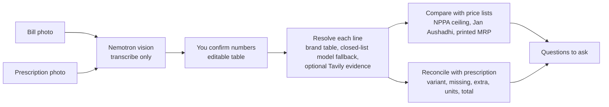

# Dawa Buddy

**Check a prescription against its bill, in plain language. Price transparency for medicines in India.**

 

Built for the [Nebius x NVIDIA Global AI Hackathon](https://nebiusglobalaihackathon.devpost.com/), **Best Apps and Agents** track.
Runs on **Nebius Token Factory** with **NVIDIA Nemotron** models. Optional **Tavily** web search for identifying unknown brands.

> Dawa Buddy never accuses anyone. It reads your documents, compares them with public price lists and the
> prescription, and tells you **what to ask**. It is information, not a finding of wrongdoing, and not medical advice.

---

## Contents
1. [The problem](#the-problem)
2. [What it does](#what-it-does)
3. [Worked examples (two real, redacted bills)](#worked-examples-two-real-redacted-bills)
4. [How it works](#how-it-works)
5. [How we use Nebius, NVIDIA Nemotron and Tavily](#how-we-use-nebius-nvidia-nemotron-and-tavily)
6. [What each result means](#what-each-result-means)
7. [Price data and how to refresh it](#price-data-and-how-to-refresh-it)
8. [Setup, run and deploy](#setup-run-and-deploy)
9. [Evaluation and honest numbers](#evaluation-and-honest-numbers)
10. [Limits and safety](#limits-and-safety)
11. [Repository layout](#repository-layout)
12. [Prior work, feedback, licence](#prior-work-feedback-licence)

---

## The problem
Indian patients rarely have the means to check what they were charged for. Three facts make that hard:

- **A prescription is hard to read.** In one Mumbai hospital-pharmacy study only about 12% of outpatients had good knowledge of
  their own prescription ([IJCMPH](https://www.ijcmph.com/index.php/ijcmph/article/view/5450); single site, small study).
- **Price control is real but patchy.** NPPA fixes legal *ceiling prices* for 930 scheduled formulations; for non-scheduled
  medicines the printed MRP may rise by at most 10% a year; supplements and consumables have no ceiling at all
  ([PIB, 8 Aug 2025](https://www.pib.gov.in/PressReleasePage.aspx?PRID=2154217)). Which rule applies to which line is not obvious.
- **Mistakes happen at the counter.** The wrong *variant* of a brand can be handed over (a real case from the author's own
  prescription and bill is in the examples below).

NPPA recovered ₹133.19 crore in 436 overcharging cases over five years (same PIB release). Most overcharging goes unnoticed because
a patient cannot compare a bill with a gazette notification. Dawa Buddy does that comparison in seconds.

## What it looks like
<p>
  
  &nbsp;&nbsp;
  
</p>

One page, one question. The result opens with a verdict, then a card for each line that needs attention (red above a legal limit, orange needs
your confirmation, yellow a question). Lines within the limits and lines no price list covers are folded away; the numbers, the prescription
explainer and the privacy notes are one tap away, not on the screen.

## What it does
A Streamlit app (`bill_app.py`) and a set of command-line tools share one core.

1. Upload a photo of the **bill** and, optionally, the **prescription**. Nemotron (vision) transcribes them. (No photo? Try a built-in sample.)
2. You **confirm the numbers** in an editable table. A misread digit must never become an accusation.
3. Every line is resolved to its medicine, strength and form, then compared with **public price lists**:
   NPPA legal ceilings, Jan Aushadhi generic prices, and the **MRP printed on the pack**.
4. The bill is **reconciled with the prescription**: missing items, extra items, **wrong variant** (for example Shelcal-XT
   prescribed, Shelcal 500 billed, with what actually differs), too many units, totals that do not add up.
5. You get a downloadable list of **questions to ask** the pharmacy, hospital or doctor.
6. On request, **"Explain my medicines in plain language"** (English, Hindi or Kannada) turns the prescription into a short briefing with auditable
   safety rules (interactions, double ingredients, paracetamol daily maximum, missing information) and a daily timetable.

### Principles that shape every decision
| Principle | What it means in the code |
|---|---|
| **Never accuse** | Only "above a legal ceiling or printed MRP" is a possible violation, always phrased as a question. Everything else is a prompt to ask. |
| **Rules decide, the model reads** | Nemotron transcribes, normalises and explains. It never decides a price tier, and it can never override a safety rule. |
| **Unknown stays unknown** | No unit, no pack size, an unreadable concentration, or an unidentified brand produces *no verdict*, with a note on what is missing. |
| **Say how much we could check** | Each audit reports the share of bill value judged against a price list and the share verified against MRP. |
| **User confirms identity** | A model's guess at a brand's salt is only a suggestion; no price judgement is made until the user confirms it from the strip. |

## Worked examples (two real, redacted bills)
Both bills and prescriptions were redacted by their owner. They are in a git-ignored folder and are **not** in this repository;
the figures below come from running the tool on them.

### 1. Outpatient pharmacy bill (4 lines)
- **Transcription:** Nemotron read all 4 lines correctly (quantity, rate, amount, unit and the printed total).
- **MRP check:** the bill prints the MRP per strip next to a per-tablet sale price. The tool converted it using tablets per strip
  and found every line sold at exactly **90% of MRP** (a consistent 10% discount). Nothing above MRP.
- **Wrong-variant warning:** the prescription said *Shelcal-XT*; the bill had *Shelcal 500*. Both start with the same brand word.
  The tool flagged it as a probable wrong dispense and told the user to check the strip. The owner confirmed it was a counter
  mistake. A first-word match would have missed it.
- **Honest gap:** none of the four lines could be judged against a *price list*: one is a supplement (no ceiling exists by design),
  two are not scheduled drugs, and one brand is not in our table. The tool says so rather than pretending.

### 2. Hospital pharmacy bill (5 lines, ₹9,845.55)
- **Transcription:** 5 of 5 lines correct on every number, and the printed total.
- **Injection:** an antiviral injection billed per vial at ₹568.14 against an NPPA ceiling of ₹541.14. That is exactly the ceiling
  plus 5% GST, so it is **within limits**.
- **IV saline: a false alarm, found and fixed.** 0.9% saline, 100 ml, was billed at ₹45.22 a bag against an ordinary-pack ceiling of
  ₹20.15 (non-glass). With only the main price list loaded, the tool raised it as a **question** (it said so in the note, because
  NPPA also publishes separate, higher ceilings for "special features" packs that we had not loaded yet). After loading those three
  notifications, the bag turned out to be an *Eurohead* pack by a manufacturer NPPA lists, with a ceiling of **₹43.07**.
  ₹43.07 plus 5% GST is **₹45.22 to the paisa**. The line is within limits.
  Worth stating plainly: the earlier flag was wrong in effect, and the design (a question, never an accusation) is what kept it harmless.
- **Coverage:** 81% of the bill value was judged against a price list. The remaining 19% is syringes and an IV set, which have no
  price list.

## How it works


**Resolving a line** (`dawa_buddy/bill.py`, `brand_table.py`):
1. A whole-brand match in a table of about 227,000 Indian brands (strength digits may be dropped, **letters never**, so `Pan D` can
   never become `Pan`, and `GLYCOMET-GP` can never become `Glycomet`).
2. A plain generic name printed on the bill, with its strength.
3. Otherwise a **closed-list model fallback**: Nemotron must pick from generics that really exist at the strength printed on the
   bill, or answer `null`. Even then the result is only a suggestion until the user confirms it.
4. Optional **Tavily** web check shows which pages say what; agreement counts only when two different sites match.

**Pricing by form** (each compares like with like and refuses to convert units it was not given):

| Form | Unit on the bill | Compared with |
|---|---|---|
| Tablet / capsule | `tab` (rate per tablet) or `strip` + `pack` (tablets per strip) | NPPA ceiling and Jan Aushadhi price per tablet |
| Syrup / suspension / drops | `bottle` + `pack` (ml) | price per ml, matched on **concentration**, not pack size |
| Cream / gel / ointment | `tube` + `pack` (gm) | price per gm |
| Injection | `vial` (or `amp`) + optional `pack` (ml it holds), or `ml` | per-vial price against per-vial lists, per-ml against per-ml; total mg and mg/ml never mixed |
| IV fluid bags | per bag, container named in the description (glass / non-glass) | ordinary ceiling, and the higher "special features" ceiling when a listed manufacturer or brand is named |
| Any product | optional `mrp` column (printed per pack) | the printed MRP |

## How we use Nebius, NVIDIA Nemotron and Tavily
Everything model-related runs on **Nebius Token Factory** through its OpenAI-compatible API
(`https://api.tokenfactory.nebius.com/v1/`, `dawa_buddy/llm.py`). The only change between local development and the submission
is an environment variable.

| Where | Model (default ID) | What it does | Why a model and not rules |
|---|---|---|---|
| Reading bill and prescription photos (`dawa_buddy/vision.py`) | `nvidia/Nemotron-3.5-Super-VL` | Transcribes lines, numbers, units, MRP and the printed total into JSON. Never judges a price. | Photos of real bills have no fixed layout. |
| Prescription reader (`reader.py`) | `nvidia/Nemotron-3_5-Lightning` | Finishes lines the rules cannot parse; output must be grounded in the source line. | Doctors write free text. |
| Brand to salt fallback (`bill.py`) | same | Picks a salt from a closed list or answers null. | Brands outside the table. |
| Explainer (`explainer.py`) | English: Lightning. **Hindi: Nemotron Ultra 550B** (Super 120B as backup). **Kannada: switched off for users** (see below); Ultra is used only when `DAWA_KN_MODEL_TEXT=1` | What each medicine is for and what to watch for, in the reader's language, checked for script before it is shown. **The dose sentence, safety notes, timetable and disclaimer are never model-written.** | Language generation for the two sentences that need it. |
| Web evidence (`webcheck.py`, optional) | **Tavily** search | Shows pages that state a brand's composition; consensus needs two sites. | Brands in no local table. |

**Where Token Factory helped.** The OpenAI-compatible endpoint meant no custom client. One interface covers both a small fast model for
everyday calls (median **1.33 s** per prescription on the 24-case eval with Lightning) and a vision-language model for photos. The model list
at `models.list()` let us confirm exact IDs the day we integrated (27 Oct 2026), including Nemotron 3 Nano 30B, Lightning, Super 120B,
Ultra and the Super VL vision model.

**What a real photo taught us about the model.** On 11 lines from two real prescriptions we compared the rules-only reader with the model.
The rules **truncated the product name on 7 of 11 lines** (`Concor T` became `Concor`, `Ecosprin Gold` became `Ecosprin`, `Roseday Gold` became
`Roseday`, `Glycomet-500 Sr` became `Glycomet-`). That matters directly: the wrong-variant warning depends on the *full* product name.
The model kept the full name on all of them. It also made one mistake: it read `STAT` (give once, now) as `SOS` (as needed). That is why
the model's output is always shown to the user for confirmation.

**Not used.** Nebius Serverless Endpoints/Jobs and AI Cloud are not used; the app runs locally or on any host that can reach Token Factory.

**Tavily.** Two uses, both *evidence for the user*, never a verdict by itself:
1. **Identify a brand** the tables cannot resolve; agreement counts only when two different sites match. Only the brand text is sent.
2. **NPPA price context** (`nppa_orders.py`). For a medicine with no ceiling of its own (a combination such as bisoprolol 5 mg + telmisartan 40 mg), Tavily searches `nppa.gov.in` only, phrased like NPPA's own order lists, and the rows are parsed from the official text. NPPA fixes such prices **company by company**: on a real bill, ten other companies' versions were priced at ₹11.60 to ₹12.71 per tablet before GST, and none of the orders found named the maker of the brand billed. So the app shows them as *"other brands of the same combination are price-controlled lower"*, with links to the orders and the sentence *"this is not a legal limit on your brand"*, and never as above-ceiling. Applying one company's price to another's brand would be a false accusation. Only the ingredients are sent, never prices, quantities or patient details (a test inspects the outgoing request).
3. **Pack size and listed MRP from pharmacy websites** (`listings.py`, one button). PharmEasy, 1mg, Truemeds and Netmeds state the strip size and the current MRP; the pack size is suggested only when two sites agree, and the MRP reference is the highest per-tablet value that two different sites support within 10%. A listed MRP is never the legal limit (1mg itself says "MRP may vary by batch"): a bill whose printed MRP is more than 10% above every listing, or a bill with no MRP charging above the listed one, gets a *question* ("ask to see the MRP on the strip"), never the above-MRP label. Pages are matched by name and strength so `Telma 40` never becomes `Telma H 40`, and Apollo is not read for prices because its pages list other products.

## What each result means
| Tier | Meaning | Is it a possible violation? |
|---|---|---|
| `above_mrp` | Charged above the MRP printed on the pack. | Yes, for any product. |
| `above_ceiling` | Above the NPPA legal ceiling (plus a GST allowance). | Yes, ask the seller to justify it. |
| `generic_gap` | At least 3x the Jan Aushadhi price for the same salt and strength. | No: a question for your doctor. |
| `ask_doctor_first` | A generic exists, but switching needs the prescriber (warfarin, thyroxine, phenytoin and similar). | No. |
| `within_benchmarks` | Within the lists we hold. | No. Not a guarantee. |
| `supplement_no_ceiling` | Supplements are not price-controlled; only the printed MRP limits them. | Only via MRP. |
| `needs_confirmation` | We have a guess for the medicine but you must confirm it from the strip (or the brand may be SR/XR, or a 3-ingredient product). | Never judged. |
| `unit_unclear` | Tablet or strip? Which pack size? Quantity x rate does not equal the amount? | Never judged. |
| `no_benchmark` | Identified, but no price list covers it. This is **not** the same as "no ceiling exists". | No. |
| `not_covered` | Consumables, devices, rooms and procedures. | No. |

## Price data and how to refresh it
| Data | Source | In the repo |
|---|---|---|
| NPPA ceilings, 911 formulations | Three gazette notifications of 25.03.2026, effective 1.4.2026 (WPI +0.64956%): 767 under NLEM 2022, 138 under NLEM 2015, 6 under NLEM 2011 | `data/nppa_ceiling_2026-04.csv` |
| NPPA ceilings, March 2026 posters | Category posters (cancer, diabetes, TB, HIV, cardio), kept only for 34 formulations the gazettes lack | `data/nppa_ceiling_2026-03.csv` |
| IV fluids in "special features" packs | Three gazette notifications of 25.03.2026 (Ringer lactate, 6 other fluids, 8 fluids) and the manufacturers entitled to them | `data/nppa_ivfluids_special_2026-04.csv`, `data/nppa_special_makers_2026-04.csv` |
| Jan Aushadhi prices | PMBJP product list, 21 Oct 2026 | `data/janaushadhi_2026-10-21.csv` |
| Brand to composition, about 227,000 names | [junioralive/Indian-Medicine-Dataset](https://github.com/junioralive/Indian-Medicine-Dataset) (MIT). Its prices are from 2022 and are discarded | `data/brand_index.json` (14 MB) |
| Hand-checked 3-ingredient brands | The brand table keeps at most two actives, so these are verified against sources | `data/brand_overrides.json` |

Sources and attribution: `data/NOTICE.md`. NPPA's PDFs are not committed; download them from NPPA and rebuild:
```bash
python3 -I scripts/parse_nppa_gazette.py data/nppa_ceiling_2026-04.csv "1 April 2026 (WPI-revised)" \
    nlem2022=NPPA-ceilings.pdf nlem2015=138-drug-revision.pdf nlem2011=six-drug-revision.pdf
python3 -I scripts/parse_nppa_ivfluids.py data/nppa_ivfluids_special_2026-04.csv data/nppa_special_makers_2026-04.csv \
    "1 April 2026 (WPI-revised)" rl=ringer_lactate.pdf six=6-special-features.pdf eight=8-special-features.pdf
python3 scripts/build_brand_index.py indian_medicine_data.csv
```
The parsers are **checked, not trusted**: serial numbers must run 1..N with no gap and every price must be a number, otherwise they stop.
That check caught a merged-cell row (`Condoms 11.65`) the table reader had skipped. Cross-check: 233 of 267 poster rows matched the new lists
with identical prices.

NPPA revises ceilings every April. When it does, download the new notifications and re-run the parsers.

## Setup, run and deploy
Python 3.10+. **No key and no photo?** Open the app and press one of the two **sample bills**: it runs fully offline against the real
price lists (the samples use invented patients and prices).
```bash
git clone <this repository>
cd dawa-buddy
python -m venv .venv && source .venv/bin/activate
pip install -r requirements-dev.txt     # requirements.txt is the runtime-only set
cp .env.example .env                  # then put your keys in .env (it is git-ignored)
set -a; source .env; set +a           # load the keys into this shell
```

**Phones.** The app is a responsive web page, not a native app: open the link in a phone browser and the file picker offers the camera. The layout is one
column and the number-checking screen is one card per line, with no table to scroll sideways. It has been checked at phone width in a headless browser,
not yet on a physical phone. Uploads up to 25 MB are accepted (phone photos are 3 to 12 MB; they are shrunk before being sent to the model).

**Run the app**
```bash
streamlit run bill_app.py
```
Start from a photo (or a sample), check the numbers once (choose how each item was sold: `tab`, `strip`, `bottle`, `tube` or `vial`, plus pack size and
printed MRP if you have them), and read the result. A medicine we cannot identify appears under "Help us identify", where you type the ingredient from
the strip or use the Tavily web check. To fix a result (for example name the saline bag's maker), open "Edit the numbers" at the bottom. If a prescription line has no readable dose (a photo can misread `0-1-0`), one amber note on the review screen lists those lines and opens the prescription box so you can fix them, instead of the app quietly saying "ask your doctor".

**Deploy on Streamlit Community Cloud**
1. Push this repository to GitHub (public; the licence is MIT).
2. On [share.streamlit.io](https://share.streamlit.io) choose *Create app*, pick the repository and branch, set the main file to `bill_app.py`,
   and under *Advanced settings* choose Python 3.11 and paste your secrets:
   ```toml
   NEBIUS_API_KEY = "..."
   TAVILY_API_KEY = "..."            # optional
   DAWA_MAX_PHOTO_READS = "5"        # photo reads per visitor session: keeps a public link from using up model credits
   ```
3. Deploy. The first build installs `requirements.txt` (about two minutes); an idle app sleeps and wakes when someone visits.

Streamlit exposes top-level secrets as environment variables, which is what the app reads. If the start screen shows only the sample buttons and no photo upload,
the key is not reaching the app: check the secret's name. The two **sample bills need no key at all**, so the link works even if the model is unreachable.
Memory is not a concern: loading the brand table and running an audit peaks at about 190 MB of Python, well inside the platform's limit.

**Command line (no browser)**
```bash
python scripts/check_nebius.py my_data/bill.JPG          # confirms key, text model and vision work
python scripts/read_photos.py --bill my_data/bill.JPG --rx my_data/prescription.JPG [--truth my_data/bill_truth.txt]
python scripts/audit_bill.py --bill my_data/bill.txt --rx my_data/rx.txt --total 1165 [--lookup]
```
`read_photos.py` writes `<photo name>_read.txt` for you to check against the paper. `--truth` scores the transcription against a bill you typed
by hand. `--lookup` adds Tavily evidence for unidentified brands.

**Bill text format** (`my_data/bill.txt`, one line per item, `#` starts a comment):
```
description | qty | rate | amount | unit | pack | mrp
# tablet: rate per tablet, MRP per strip of 15 tablets
SHELCAL 500MG TAB | 30 | 9.81 | 294.21 | tab | 15 | 163.45
# syrup: a 60 ml bottle
OMNACORTIL FORTE SYRUP | 1 | 90.00 | 90.00 | bottle | 60
# injection: priced per vial
CEFTRIAXONE 250MG INJ | 1 | 29.50 | 29.50 | vial
# IV bag: name the container (glass / non-glass) if you know it
NS 0.9% 100ML NON-GLASS | 13 | 21.00 | 273.00
```
Comments must be whole lines starting with `#`; trailing comments break the row.
`mrp` is always the MRP printed on the **pack** (per strip, bottle, tube or vial), as bills print it. With a per-tablet rate, give `pack`
(tablets per strip) so the tool can compare.

**Modes**
| `DAWA_PROVIDER` | Behaviour |
|---|---|
| `nebius` (default when `NEBIUS_API_KEY` is set) | Nemotron on Token Factory |
| `ollama` | Local model, no cloud (`OLLAMA_MODEL`, `DAWA_VISION_MODEL`) |
| `offline` | Rules only, clearly labelled; no photo reading |

Optional: `DAWA_TEXT_MODEL`, `DAWA_VISION_MODEL`, `NEBIUS_BASE_URL`, `TAVILY_API_KEY`.

**Tests and evaluations**
```bash
pytest -q tests                                  # 160 tests
python -m evals.run_bill_evals                   # 18 synthetic bill lines, tier accuracy
python -m evals.run_brand_evals [--verbose]      # 108 brand lines, correct / missed / wrong
python -m evals.run_evals --out evals/results.md # 24 synthetic prescriptions, live model
python -m evals.run_lang_evals --out evals/results_lang.md   # Hindi and Kannada explainer, live models
DAWA_PROVIDER=offline python -m evals.run_evals --out evals/results_offline.md
```

## Evaluation and honest numbers
All claims below are reproducible with the commands above. Where a number is weak, it says so.

| Check | Result | Caveat |
|---|---|---|
| Unit and integration tests | 160 pass | Includes fake-server tests for the Ollama and Tavily paths. |
| Brand resolution, 108 real brand lines | **99 correct, 4 missed (safe), 0 wrong**; the curated map alone: 26 correct, 61 missed, 2 wrong (1 reached a price verdict) | Expected answers were written from pharmaceutical knowledge, **not** copied from the table. A pharmacist should review them. 14 of 14 supplements/invented/ambiguous names handled safely. |
| Bill tier accuracy, 18 synthetic lines | 18 of 18 | Synthetic prices, written by the author. |
| Prescription extraction, 24 synthetic cases | offline rules F1 **1.00**, live Nemotron F1 **1.00**; safety-flag F1 1.00 / 1.00; 0 invented medicines; median latency 1.33 s | **Saturated.** The rules were tuned on this style of text, so both modes score perfectly. It does not show the model's value; the real-photo comparison below does. |
| Real bill photos | 4 of 4 and 5 of 5 lines transcribed with every number correct | Two bills, so an anecdote, not a benchmark. |
| Real prescription photos | 11 lines: model kept the full product name where the rules truncated it on 7; made 1 error (`STAT` read as `SOS`); one dose pattern `0---1---0` was read as `0---0` on an earlier photo | Two prescriptions. This is why every transcription is shown for confirmation. |
| Hindi and Kannada explainer, live | Hindi: **good in every run I read**, accepted by the script check in all runs, 1.7 to 5 s. Kannada: also accepted by the script check, **but a real run produced fluent-looking nonsense** (place names and the word "Friday" as a medicine's side effects) that no script check can catch. **So Kannada AI-written text is off by default**; Kannada readers get the AI lines in English with a notice, and everything else in Kannada | A script check proves the alphabet, not the meaning. No native speaker has reviewed Hindi or Kannada yet: `docs/language_review.md` is the pack for that. `python -m evals.run_lang_evals`, results in `evals/results_lang.md`. |
| NPPA price context for an unpriced combination (live, Tavily) | 10 distinct company rows from 4 NPPA documents for bisoprolol 5 mg + telmisartan 40 mg, parsed correctly against rows copied from the documents (4 parser tests) | One combination checked live. The parser reads only the 'composition, unit, company, price' list layout; other layouts and PDFs without extractable text return nothing, not a guess. |
| Pharmacy-website lookup, real bill (live, Tavily) | **Pack sizes right for 6 of 6 products where the strip is known** (and Telma 40 found as 30); the bill went from **0% to 100% checked** with one button; listed MRPs equalled the printed MRP exactly for Concor T and Shelcal, and for Veltam's newer batch. One brand (Pantop) had no two sites within 10% and correctly got no reference | 6 products, one day. Listings change and sites disagree, which is why every result is a question and the reference needs two sites. |
| Not yet measured | Handwriting, other bill layouts, real-user feedback, native-speaker review of Hindi and Kannada | |

## Limits and safety
- **It is not medical advice and not a legal finding.** It never diagnoses and never changes a dose. Every flag is a prompt to ask someone.
- **Coverage is partial.** NPPA ceilings exist only for scheduled drugs; most branded medicines have none. Consumables, devices, rooms and
  procedures have no price list. The tool reports the share it could check and never presents "no benchmark" as "fine".
- **The brand table is third-party** and keeps at most two ingredients per product. A table hit is priced but labelled "check the strip";
  combinations that match a benchmark go to `needs_confirmation`; a product listed only as SR/XR when the bill does not say so also does.
- **Special-features IV packs** have manufacturer-specific restrictions in NPPA's notes (some makers qualify for only some sizes). Naming a
  listed manufacturer is treated as a signal, not proof.
- **GST allowance.** Ceilings exclude local taxes; the tool allows up to 12% before flagging, which can hide a small overcharge but avoids false alarms.
- **Photos may contain personal data.** Cover names, phone numbers, addresses and bill numbers before uploading. Photos are sent to Nebius Token
  Factory for transcription; only brand text is sent to Tavily; the apps store nothing.
- **Interaction and brand-safety tables are small demo sets** to be replaced with a licensed clinical database before real use.
- **Hindi and Kannada: what is fixed and what is AI.** Fixed, never model-written, in `explainer.PHRASES` and `i18n.py`: the dose sentence, every safety note, the daily timetable and its share text, severity headings and the disclaimer (about 70 short phrases). What each medicine is for and what to watch for: **Hindi** is AI-written (it passed my reading) and labelled as such. **Kannada** AI text is switched off (see the evaluation table); instead, for about 175 common ingredients (and combinations of them) the Kannada reader gets a **fixed table** (`medinfo.py`, built from short reviewable pieces: purpose, side effects, warnings; no dose advice), with a notice saying it is general information from a list, not AI. An ingredient not in the table is never guessed: the reader sees the English AI line with a notice. A new safety rule cannot reach a family untranslated: a test fails if a rule has no Hindi and Kannada sentence. Nothing here has had a native-speaker review yet.
- **Unverified:** wording of the fixed Hindi and Kannada phrases (review pack ready), Hindi AI text over many prescriptions, handwriting, and real-user outcomes.

## Repository layout
```
bill_app.py                 The app (Streamlit): photo or sample -> confirm -> verdict, cards, questions, plain-language briefing
docs/                       Screenshots used in this README
scripts/build_review_pack.py Writes docs/language_review.md for native-speaker review
scripts/ui_preview.py       Every component of the visual layer on one page: streamlit run scripts/ui_preview.py
.streamlit/                 Streamlit settings
dawa_buddy/
  bill.py                   Line resolution, tiers, per-form pricing, MRP check
  brand_table.py            Brand -> composition lookup (whole-brand, never guesses)
  benchmarks.py, ceilings.py  Jan Aushadhi and NPPA loaders and matchers
  liquids.py, injectables.py  Per-ml / per-gm, per-vial and IV-fluid pricing
  reconcile.py              Prescription vs bill, wrong-variant warning
  vision.py                 Photo -> structured rows (downscales large photos)
  webcheck.py               Tavily evidence for unidentified brands
  reader.py, safety.py, explainer.py, scheduler.py, pipeline.py   Prescription reading and the plain-language briefing
  llm.py                    Nebius / Ollama / offline client
  report.py                 "Questions to ask" document
  i18n.py                   Fixed Hindi and Kannada text: safety notes, timetable, disclaimer (no model)
  medinfo.py                Fixed Kannada/English purpose and watch-for table for common ingredients (no model)
  ui.py                     Visual layer: design tokens, fonts, widget restyling, HTML builders (header, verdict, cards, price meter)
  samples.py                Two built-in synthetic sample bills (one-click demo, no key needed)
data/                       Price lists, brand table, overrides, NOTICE.md
scripts/                    audit_bill, read_photos, check_nebius, parsers for NPPA PDFs, brand-table builder
evals/                      Gold sets and runners
tests/                      160 tests
my_data/                    Your private bills and prescriptions (git-ignored)
```

## Prior work, feedback, licence
**Prior work and the submission period.** None. Everything in this repository was built for this hackathon: the *prescription briefing*
(reader, safety rules, scheduler, explainer) and the *bill check* (`bill_app.py`: photo reading, the brand table, per-form pricing for
tablets, liquids, injections and IV fluids, the MRP check, reconciliation with the wrong-variant warning, the NPPA data pipeline and the Tavily
evidence step).

**Feedback on Nebius Token Factory and NVIDIA models** (as used here):
- The OpenAI-compatible API and `models.list()` made integration fast; the exact model IDs are visible and confirmable.
- Real bill and prescription photos are about 4 MB. We downscale to 1800 px and fix EXIF rotation before upload; guidance on recommended
  image sizes for the vision model would help.
- Nemotron Super VL transcribed printed bills exactly on the two bills tried, but occasionally dropped a digit in a long dose pattern and
  confused `STAT` with `SOS`. Grounding checks and user confirmation are essential for medical text.
- Languages: the fast default model (Lightning) answered Hindi and Kannada requests **in English**, with no error. Nemotron Super 120B wrote clean Hindi but, for Kannada, mixed in Bengali and Arabic letters. Nemotron Ultra 550B wrote clean Hindi and usable-looking Kannada, but on a real prescription three of four Kannada side-effect lines were nonsense in valid script, so we cannot ship free-form Kannada medical text from it. Per-model language benchmarks, or a documented list of supported languages, would have saved us a day.

**Licence.** MIT (see `LICENSE`). Data attributions are in `data/NOTICE.md`.
